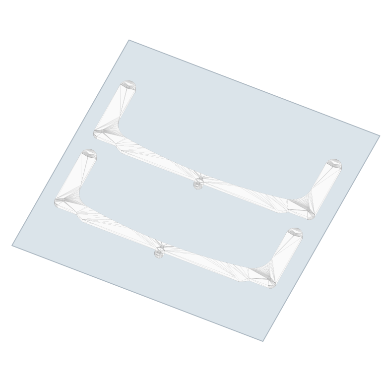

# Corrected funnel top — 3v3 + 4v4

Use these files for the corrected funnel top supplied on 2026-10-13. The earlier top-funnel projects used the wrong STL. The two superseded active projects are retained in KY/archive/ and JL/archive/ with `Superseded-WrongTop-2026-10-13` filenames.

Source: [FunnelTop-3v3-4v4-Corrected.stl](models/FunnelTop-3v3-4v4-Corrected.stl), copied from Kyle’s `FunnelTop3v3+4v4(1).stl`. Dimensions: **225 × 82.489 × 2 mm**.

**All six projects are white, with two copies per plate**, 3 mm part clearance, flat on Textured PEI, printed by layer. The supplied geometry and hole positions are unchanged. Layer height is 0.3 mm; KY/TC first layer 0.2 mm, JL first layer 0.3 mm. Existing funnel settings use no supports or brim. KY/TC use 3 walls, JL 4 walls; all retain 3 top and 3 bottom shells with 7% gyroid infill.

| Owner | Printer / nozzle | JP PETG White | Official Bambu PETG Basic White |
|---|---|---|---|
| KY | P2S 0.8 HF | [Download .3mf](https://github.com/Kowls0419/WRG-MASS-PRINTING/raw/refs/heads/main/KY/KY-FunnelTop_P2S_0.8HF_TexturedPEI_JPPETG.3mf) — ~28 min / 19.2 g | [Download .3mf](https://github.com/Kowls0419/WRG-MASS-PRINTING/raw/refs/heads/main/KY/KY-FunnelTop_P2S_0.8HF_TexturedPEI_BambuPETG.3mf) — ~29 min / 18.9 g |
| TC | X2D 0.8 HF | [Download .3mf](https://github.com/Kowls0419/WRG-MASS-PRINTING/raw/refs/heads/main/TC/TC-FunnelTop_X2D_0.8HF_TexturedPEI_JPPETG.3mf) — ~26 min / 19.2 g | [Download .3mf](https://github.com/Kowls0419/WRG-MASS-PRINTING/raw/refs/heads/main/TC/TC-FunnelTop_X2D_0.8HF_TexturedPEI_BambuPETG.3mf) — ~27 min / 18.9 g |
| JL | P2S 0.6 HF | [Download .3mf](https://github.com/Kowls0419/WRG-MASS-PRINTING/raw/refs/heads/main/JL/JL-FunnelTop_P2S_0.6HF_TexturedPEI_JPPETG.3mf) — ~36 min / 21.1 g | [Download .3mf](https://github.com/Kowls0419/WRG-MASS-PRINTING/raw/refs/heads/main/JL/JL-FunnelTop_P2S_0.6HF_TexturedPEI_BambuPETG.3mf) — ~37 min / 20.8 g |

JP PETG retains the existing team profiles: 230°C nozzle / 225°C first layer, Textured PEI 65°C, max flow 28 mm³/s.

Bambu PETG Basic uses the installed official profile for each exact printer/nozzle: 250°C nozzle / 245°C first layer, Textured PEI 70°C. The official High Flow variant limit is 23 mm³/s. The projects embed the matching official filament preset and its extruder-variant template. TC uses filament 1 on the left nozzle.

Open the matching project as a fresh file in Bambu Studio, select white filament, slice, and print. Older release downloads, the original STL collection, and the special public snapshot retain the previous top geometry; use the corrected downloads above for this part.
