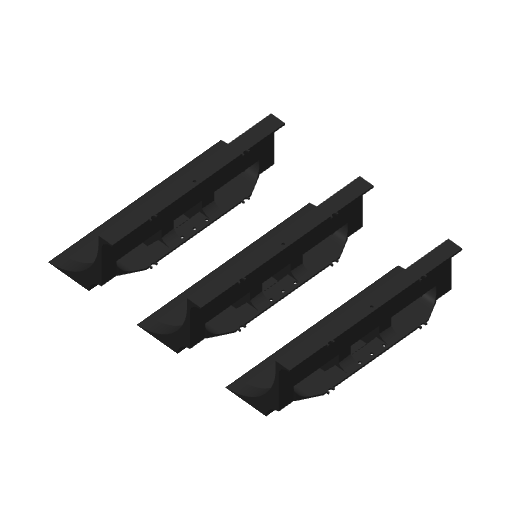
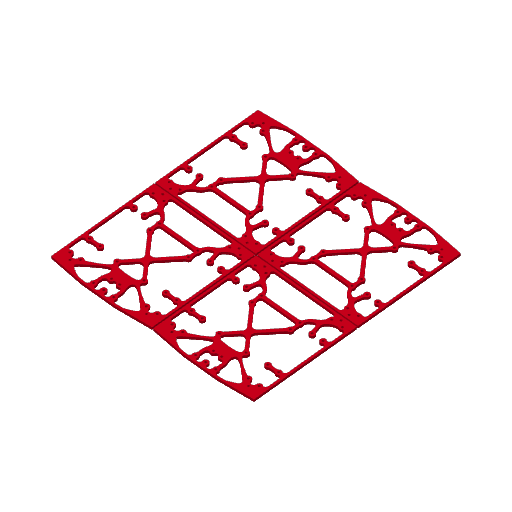
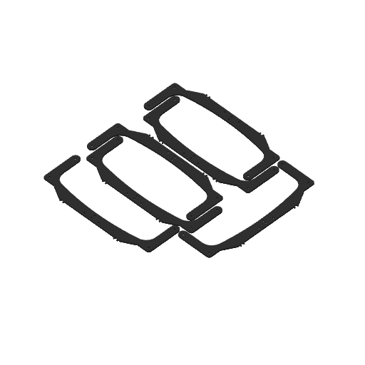

# H2C print projects / H2C 列印專案

[Download from the bilingual public release](https://github.com/Kowls0419/WRG-MASS-PRINTING/releases/tag/2026-wrg-kcis-xg-public) · [Back to all printers](../README.md)

[從中英雙語公開發佈下載](https://github.com/Kowls0419/WRG-MASS-PRINTING/releases/tag/2026-wrg-kcis-xg-public) · [返回所有印表機](../README.md)

Original supplied WRG projects, unchanged. Previews are the saved Bambu Studio plate images embedded in each project. These projects are available as individual release Assets and in the updated complete ZIP.

保留提供的 WRG 原始專案內容。預覽取自各專案內儲存的 Bambu Studio 列印盤圖片。檔案可於發佈頁個別下載，亦包含於更新後的完整 ZIP。

| Part / 零件 | Preview / 預覽 | Project / 專案 | Settings / 設定 |
|---|---|---|---|
| Sumo / 相撲機器人零件 |  | [FinalSumo.3mf](FinalSumo.3mf) | H2C 0.4 SF; Bambu PETG Basic Black; Textured PEI 70°C; 0.2 mm layers; 2 walls; 5/3 shells; 15% infill; 3 per plate |
| New bottom board / 新版底板 |  | [new board.3mf](new%20board.3mf) | H2C 0.4 SF; Bambu PETG Basic Red; Textured PEI 70°C; 0.2 mm layers; 4 walls; 5/3 shells; 7% infill; 4 per plate |

Open as a project in Bambu Studio and review the selected printer, nozzle, filament and slice before printing. Physical test results have not been recorded here.

請在 Bambu Studio 以專案開啟，列印前確認印表機、噴嘴、耗材與切片結果。此處尚未記錄實體試印結果。

## Stronger intake pockets / 加厚吃球口口袋 — 2026-11-11

Supplied projects preserved unchanged. / 完整保留提供的原始專案。

| Part / 零件 | Preview / 預覽 | Project / 專案 | Nozzle / 噴嘴 | Filament / 耗材 | Parts per plate / 每盤零件數 |
|---|---|---|---|---|---|
| 5 mm bottom / 5 mm 底層 |  | [h2c-intake-pocket-bottom-5mm-red.3mf](h2c-intake-pocket-bottom-5mm-red.3mf) | 0.4 SF | Red Bambu PETG Basic / 紅色 Bambu PETG Basic | 1 |
| 3 mm mid / 3 mm 中層 |  | [h2c-intake-pocket-mid-3mm-black.3mf](h2c-intake-pocket-mid-3mm-black.3mf) | 0.4 SF | Black Bambu PETG Basic / 黑色 Bambu PETG Basic | 1 |

0.2 mm layers, 4 walls, 5/3 shells, 15% infill. / 0.2 mm 層高、四道牆、上／下殼層 5／3 層、15% 填充。
