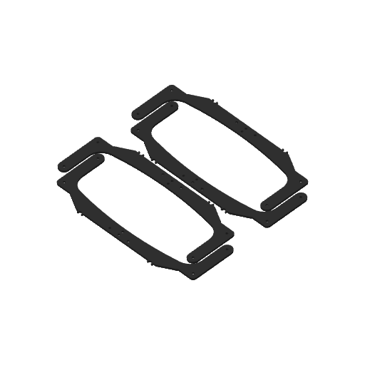

# P2S print projects / P2S 列印專案

[Public release / 公開發佈](https://github.com/Kowls0419/WRG-MASS-PRINTING/releases/tag/2026-wrg-kcis-xg-public) · [All printers / 所有印表機](../README.md)

## Stronger intake pockets / 加厚吃球口口袋 — 2026-11-11

Supplied projects preserved unchanged. / 完整保留提供的原始專案。

| Part / 零件 | Preview / 預覽 | Project / 專案 | Nozzle / 噴嘴 | Filament / 耗材 | Parts per plate / 每盤零件數 |
|---|---|---|---|---|---|
| 3 mm mid / 3 mm 中層 |  | [p2s-intake-pocket-mid-3mm-black.3mf](p2s-intake-pocket-mid-3mm-black.3mf) | 0.4 HF | Black Generic PETG / 黑色 Generic PETG | 4 |

0.2 mm layers, 4 walls, 5/3 shells, 15% infill. / 0.2 mm 層高、四道牆、上／下殼層 5／3 層、15% 填充。
