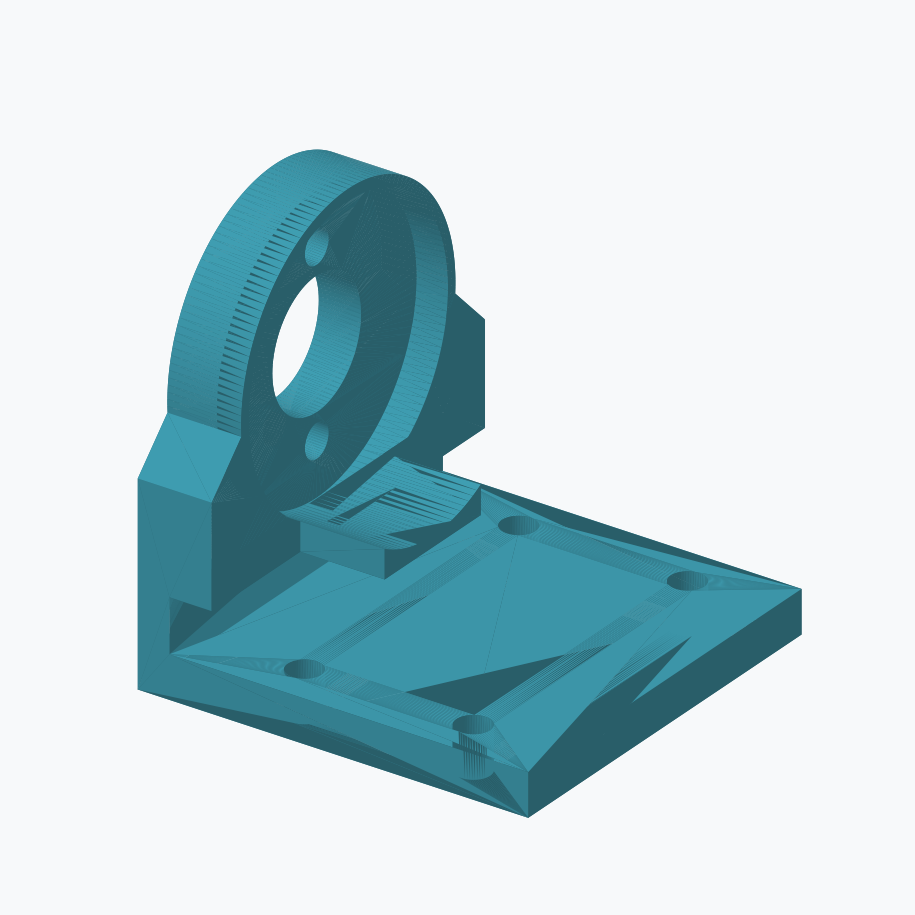
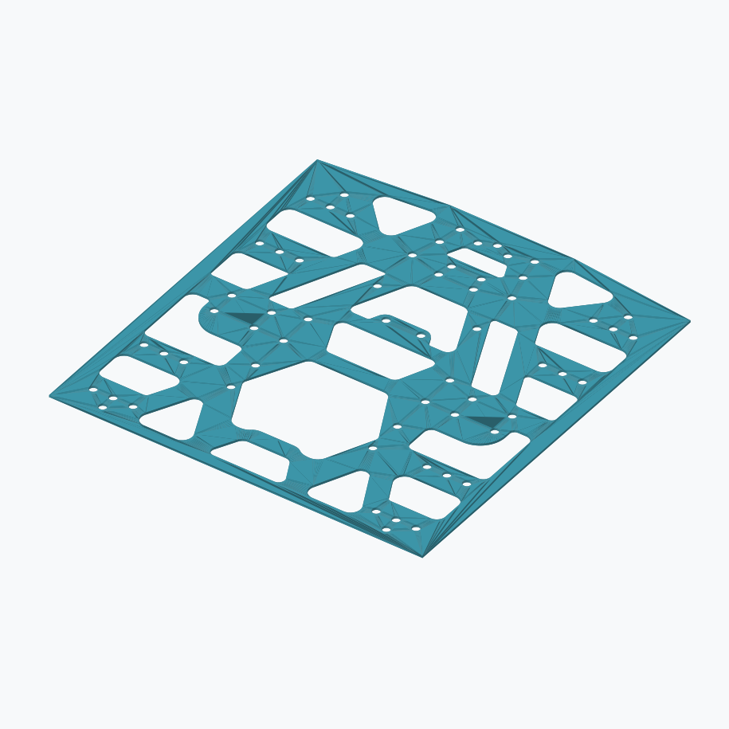
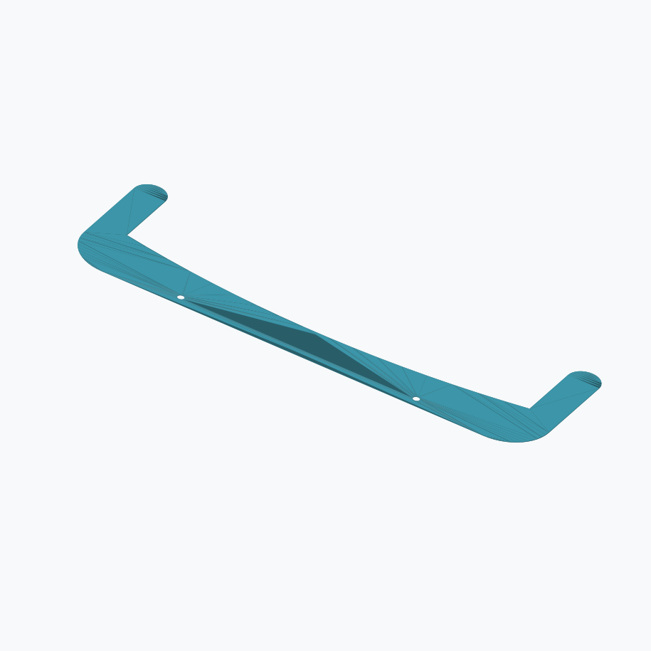
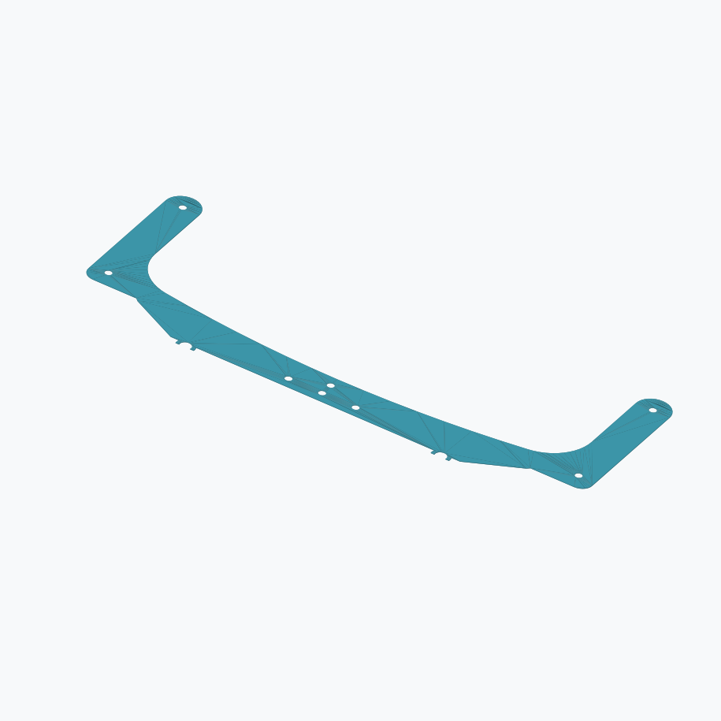
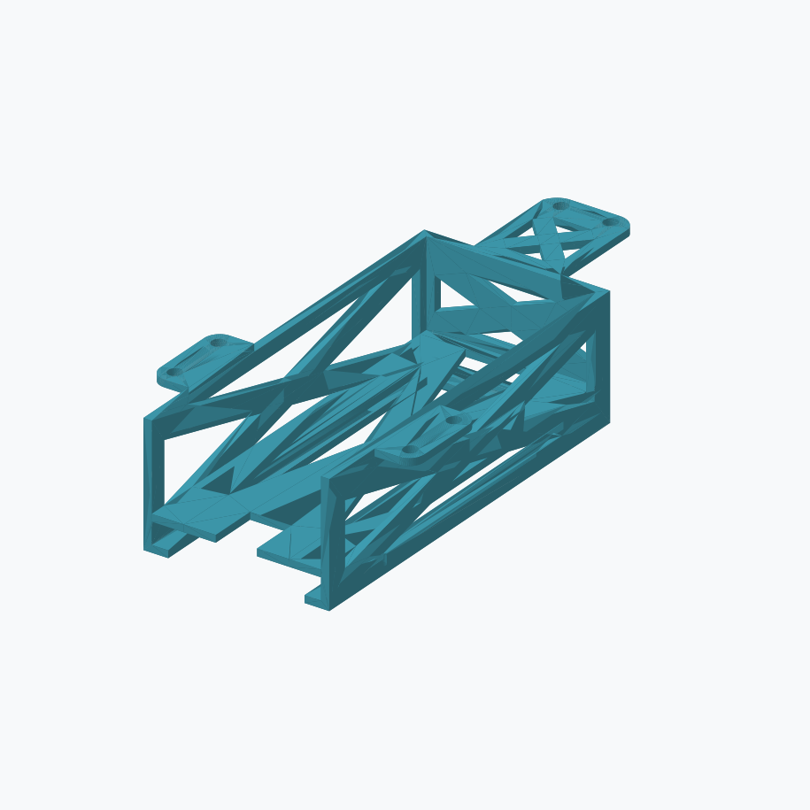

# WRG Mass Printing — Bambu Studio print files

Working print files and public model releases for the WRG robotics team. Check each file’s status below.

WRG 機器人團隊的列印工作檔案與公開模型發佈；請參閱下方各檔案的狀態。

## 2026 WRG KCIS-XG Public Release

[Download the special public release](https://github.com/Kowls0419/WRG-MASS-PRINTING/releases/tag/2026-wrg-kcis-xg-public) · [Models and documentation](public-release/) · [Custom .3mf print configurations](public-release/print-configs/)

MIT-licensed motor stand, bottom board, ball intake top, ball intake bottom, and standard battery box. Includes single-part STL files and **STL → STEP conversions**. This is a fixed public snapshot; working print projects below continue to evolve.

採用 MIT 授權公開馬達支架、底板、吃求口（之後提供）的上片與下片與電池匣，包含單一零件 STL 與 **STL → STEP 轉換檔案**。本次公開發佈為固定快照；下方的列印工作專案仍持續更新。

**The complete ZIP includes all eight custom `.3mf` print configurations.**

**完整 ZIP 壓縮檔內含八個自訂 `.3mf` 列印設定檔。**

### Part previews / 零件預覽

| Part / 零件 | Preview / 預覽 |
|---|---|
| Motor stand / 馬達支架 |  |
| Bottom board / 底板 |  |
| Ball intake top / 吃求口（之後提供）—上片 |  |
| Ball intake bottom / 吃求口（之後提供）—下片 |  |
| Standard battery box / 電池匣 |  |

## ⬇️ How to get your files

- **Easiest:** go to **[Releases → Latest](../../releases/latest)** and download the complete ZIP from *Assets*; the custom `.3mf` files are inside. The special public release includes the complete ZIP; working-release notes describe their own file status.
- **Always-newest single file:** open your folder below → click the file → **Download raw file** (↓ icon).
- **What changed:** open a file → **History**.

Open the `.3mf` in Bambu Studio, check the plate/filament match your printer, slice, and print. **Slice and send without saving** — saving in Studio wipes the file's list of overridden settings.

## KY (Kyle)

| File | Printer / nozzle | Filament | Plate | Layer / walls / shells / infill | Max flow | Copies | Status |
|---|---|---|---|---|---|---|---|
| [`KY-FinalBottom_P2S_0.8HF_TexturedPEI_JPPETG.3mf`](KY/KY-FinalBottom_P2S_0.8HF_TexturedPEI_JPPETG.3mf) | P2S 0.8 HF | JP PETG | Textured PEI 65°C | 0.3 / 3 / 3-3 / 7% | 28 | 1 | ✅ mass printing — flow 28 not yet test-printed |
| [`KY-BatTop-Standard_P2S_0.8HF_TexturedPEI_JPPETG.3mf`](KY/KY-BatTop-Standard_P2S_0.8HF_TexturedPEI_JPPETG.3mf) | P2S 0.8 HF | JP PETG | Textured PEI 70°C | adaptive 0.16–0.56 / 3 / 2-2 / 7% | 28 | 12 | ✅ mass printing (60 needed = 5 plates) — **verified Standard mesh**, standing on end, settings from TEST3: Tree Slim (top Z 0.3 / XY 0.4), anti-sway speeds, seam fix, auto brim 5 mm. ✅ **12-copy plate test-printed successfully (2026-10-04)** |

## JL (Justin)

| File | Printer / nozzle | Filament | Plate | Layer / walls / shells / infill | Max flow | Copies | Status |
|---|---|---|---|---|---|---|---|
| [`JL-motorstand_P2S_0.4SF_TexturedPEI_BambuPETG.3mf`](JL/JL-motorstand_P2S_0.4SF_TexturedPEI_BambuPETG.3mf) | P2S 0.4 SF | Bambu PETG Basic Black | Textured PEI 70°C | 0.2 / 6 / 5-5 / 20% | 15 | 36 | ✅ ready — official Bambu PETG Basic 0.4 filament profile; converted from the 0.6 HF motorstand (same wall/shell thickness), 383 g / ~12 h 27 m, not yet test-printed at 0.4mm |
| [`JL-FunnelTop_P2S_0.6HF_TexturedPEI_JPPETG.3mf`](JL/JL-FunnelTop_P2S_0.6HF_TexturedPEI_JPPETG.3mf) | P2S 0.6 HF | JP PETG Black | Textured PEI 65°C | 0.3 / 4 / 3-3 / 7% | 28 | 4 | ⚠️ **released before test print** — **4v4 Funnel – Top** (1 per bot, 53 needed = 14 plates). 225 × 70 × 2 mm, flat, no supports, no brim. FinalBottom settings ported to 0.6 HF (4 walls ≈ 2.48 mm). ~1 h 24 m, 62 g per plate. test print 2026-10-05 |

## TC (Terry)

| File | Printer / nozzle | Filament | Plate | Layer / walls / shells / infill | Max flow | Copies | Status |
|---|---|---|---|---|---|---|---|
| [`TC-FinalBottom_X2D_0.8HF_TexturedPEI_JPPETG.3mf`](TC/TC-FinalBottom_X2D_0.8HF_TexturedPEI_JPPETG.3mf) | X2D 0.8 HF | JP PETG | Textured PEI 65°C | 0.3 / 3 / 3-3 / 7% | 28 | 1 | ✅ ready — X2D 0.8HF printer preset unverified |
| [`TC-FunnelBottom_X2D_0.8HF_TexturedPEI_JPPETG.3mf`](TC/TC-FunnelBottom_X2D_0.8HF_TexturedPEI_JPPETG.3mf) | X2D 0.8 HF | JP PETG Grey | Textured PEI 65°C | 0.3 / 3 / 3-3 / 7% | 28 | 4 | ⚠️ **released before test print** — **4v4 Funnel – Bottom on TC's X2D** (helps with the 106 bottoms). Same 4-per-plate layout and settings as `KY-FunnelBottom`, on the X2D 0.8 nozzle printer preset (both nozzles 0.8, as Studio defines it), JP PETG, filament 1 on the left nozzle. Saved clean from Studio (no orange). |

## 🧪 WIP — being tested, don't print yet

| File | Printer / nozzle | Filament | Plate | Layer / walls / shells / infill | Max flow | Copies | Status |
|---|---|---|---|---|---|---|---|
| [`KY-BatTop-Standard-TEST3_P2S_0.8HF_TexturedPEI_JPPETG.3mf`](WIP/KY-BatTop-Standard-TEST3_P2S_0.8HF_TexturedPEI_JPPETG.3mf) | P2S 0.8 HF | JP PETG | Textured PEI 70°C | 0.3 / 3 / 2-2 / 7% | 28 | 6 | 🧪 **STANDARD BatTop (verified mesh, 60 needed)**. 64 × 115 × 34 mm. **3 plates, by layer:** plate 1 = one flat upside-down copy (34 mm) + one standing (115 mm); plate 2 = 3 standing copies; plate 3 = 1 standing copy with **adaptive layer height (0.16–0.56 mm)**. **Standing won the first test** (supports came off easily). Supports now tuned for standing: Tree Slim, expansion 0, interface spacing 0.8, top Z 0.3 (1 layer) / XY 0.4, on part layers. No layer-range rules, seam fix, auto brim 5 mm. **Anti-sway:** accel 2000 / outer wall 1000 / travel 2500, travel 300 mm/s, walls 80 outer / 120 inner, spiral Z-hop |
| [`KY-BatTop-SpecialEd-TEST2_P2S_0.8HF_TexturedPEI_JPPETG.3mf`](WIP/KY-BatTop-SpecialEd-TEST2_P2S_0.8HF_TexturedPEI_JPPETG.3mf) | P2S 0.8 HF | JP PETG | Textured PEI 70°C | 0.3 / 3 / 2-2 / 7% | 28 | 1 | 🧪 **SPECIAL edition BatTop**. 64 × 99.5 × 34 mm, vertical, Tree Hybrid, seam fix (formerly named Standard-TEST2) |
| [`KY-FunnelBottom_P2S_0.8HF_TexturedPEI_JPPETG.3mf`](KY/KY-FunnelBottom_P2S_0.8HF_TexturedPEI_JPPETG.3mf) | P2S 0.8 HF | JP PETG Grey | Textured PEI 65°C | 0.3 / 3 / 3-3 / 7% | 28 | 4 | ⚠️ **released before test print** — **4v4 Funnel – Bottom** (2 per bot, 106 needed = 27 plates). 225 × 85.7 × 2 mm, flat, no supports, no brim. FinalBottom settings unchanged. test print 2026-10-05 |
| [`KY-FunnelTop_P2S_0.8HF_TexturedPEI_JPPETG.3mf`](KY/KY-FunnelTop_P2S_0.8HF_TexturedPEI_JPPETG.3mf) | P2S 0.8 HF | JP PETG Black | Textured PEI 65°C | 0.3 / 3 / 3-3 / 7% | 28 | 4 | ⚠️ **released before test print** — **4v4 Funnel – Top on Kyle's printer** (helps JL with the 53 tops). Same tops layout as `JL-FunnelTop`, KY-FunnelBottom settings (3 walls ≈ 2.46 mm = JL's 4 × 0.62). |
| [`JL-BatTop-Standard_P2S_0.4SF_TexturedPEI_JPPETG.3mf`](WIP/JL-BatTop-Standard_P2S_0.4SF_TexturedPEI_JPPETG.3mf) | P2S 0.4 SF | JP PETG Yellow | Textured PEI 70°C | 0.2 / 6 / 3-3 / 7% | 12 | 12 | 🧪 not released yet — **verified Standard mesh**, 12 standing copies, KY's tested settings scaled to 0.4 (Tree Slim top Z 0.2 / XY 0.4, anti-sway, seam fix). 330 g, ~36 h 17 m at fixed 0.2 layers; **add Adaptive layer height in Studio**. Not yet test-printed at 0.4 |
| [`KY-BatTop-Standard_P2S_0.8HF_TexturedPEI_BambuPETG.3mf`](WIP/KY-BatTop-Standard_P2S_0.8HF_TexturedPEI_BambuPETG.3mf) | P2S 0.8 HF | Bambu PETG Basic Yellow | Textured PEI 70°C | adaptive 0.16–0.56 / 3 / 2-2 / 7% | 21 | 12 | 🧪 same as the released KY BatTop Standard (12 standing copies) but with the **official Bambu PETG Basic 0.8 profile**: 250/245 °C, retraction 0.4, max flow 21, fan max 60%. Not yet test-printed |

## Archive

- 2026-10-02: all other WIP files moved to [`archive/`](archive): the 3 BatTop weight tests, the wrong-mesh KY + JL BatTop Standard, TEST1, the old JL SpecialEd 0.4 SF file, KY-Body2 and `BatTop for standard.stl` (the SpecialEd mesh).
- `KY/archive/KY-motorstand_P2S_0.6HF_TexturedPEI_JPPETG.3mf` — retired from active printing 2026-09-30.
- `JL/archive/JL-motorstand_P2S_0.6HF_SuperTack_BambuPETG.3mf` — replaced by the 0.4 SF (Bambu PETG Basic black) version 2026-09-30.

Old baselines and the abandoned stack-printing (PLA interface) experiments are in [`archive/`](archive).

## Notes

- Name format: `OWNER-Part_Printer_Nozzle_Plate_Filament.3mf` — `SF` = standard-flow nozzle, `HF` = high-flow.
- Every file has a built-in process preset that matches its settings exactly, so Studio shows no orange "modified" values. If you see orange, you or Studio changed something: slice and send without saving.
- PETG on 0.6/0.8 HF nozzles is capped at 28 mm³/s max volumetric flow; 0.4 standard nozzles stay at 12–15.

## Single-part STL collection

- 2026-10-09: [`Original STLs/`](Original%20STLs/) contains the six current parts and five archived revisions, with 17 experimental pieces in its `Experimental/` subfolder. Extracted and deduplicated across all 78 source files; provenance and dimensions are recorded inside the folder.
