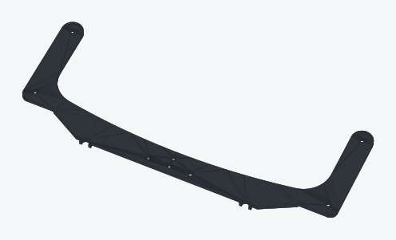
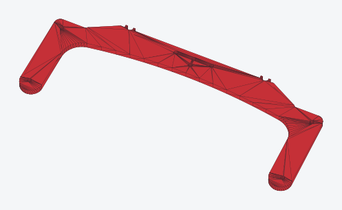
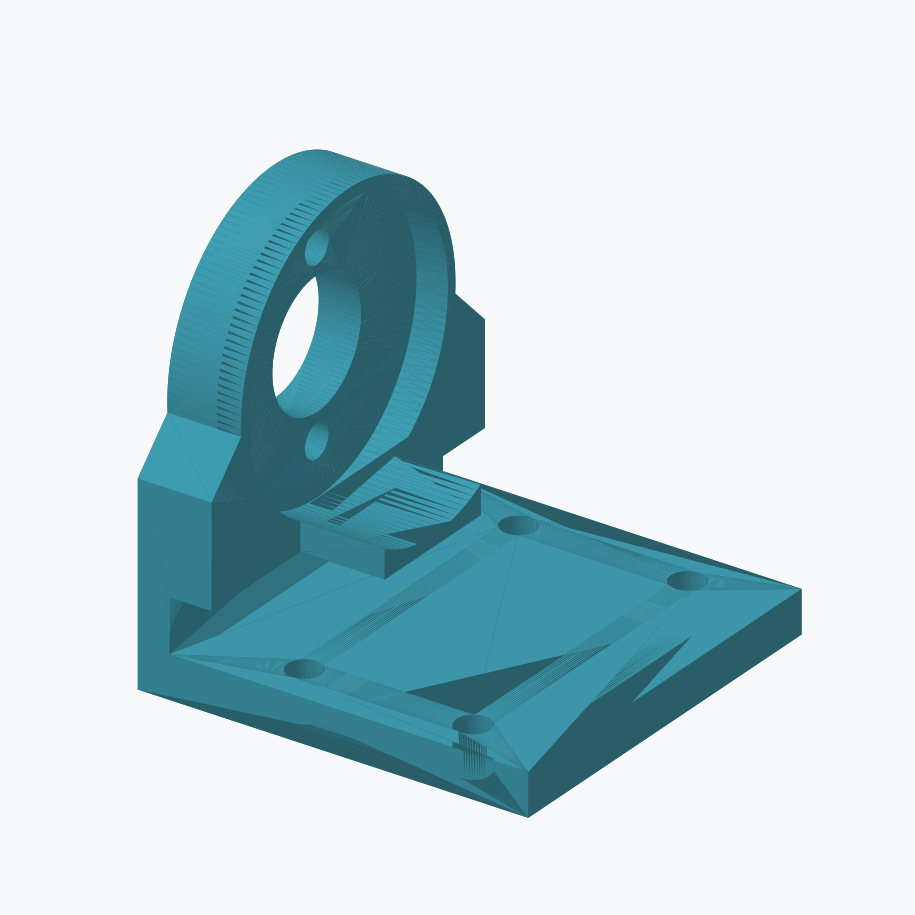
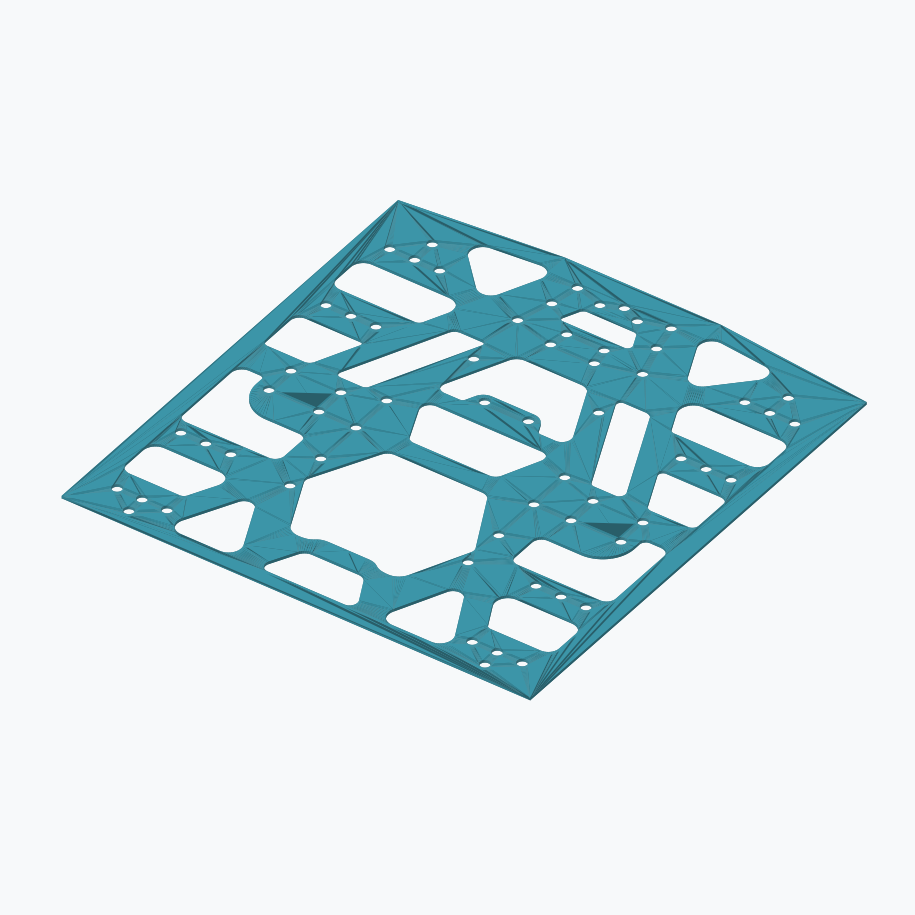
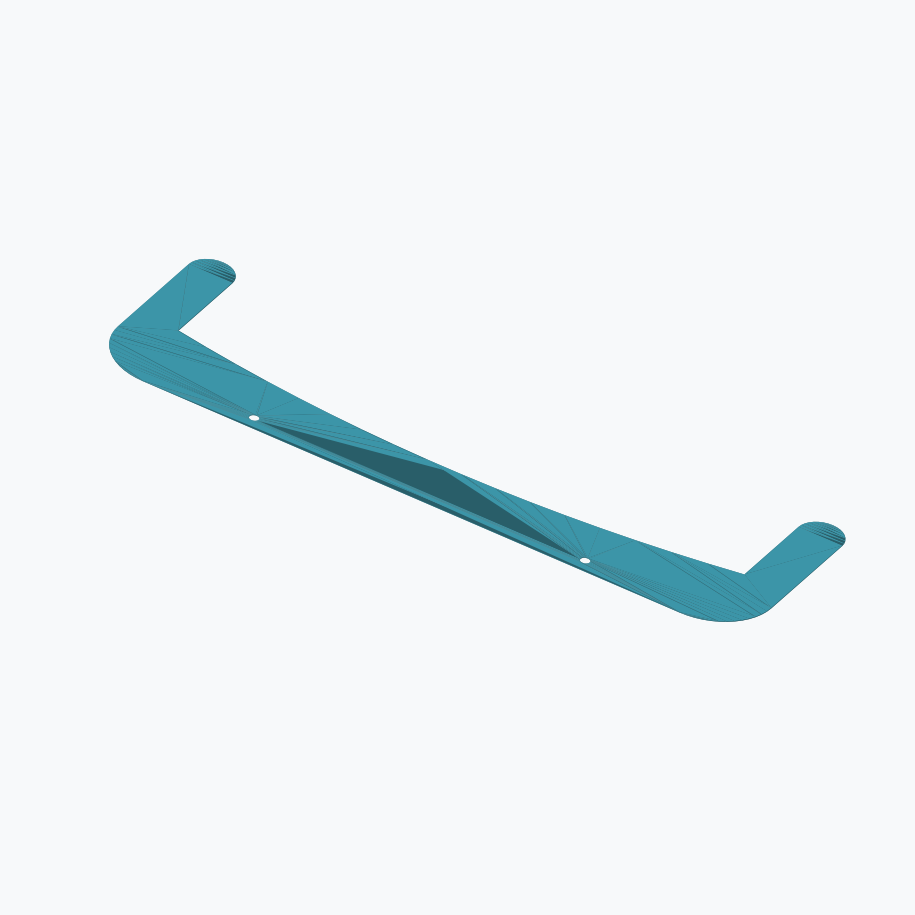
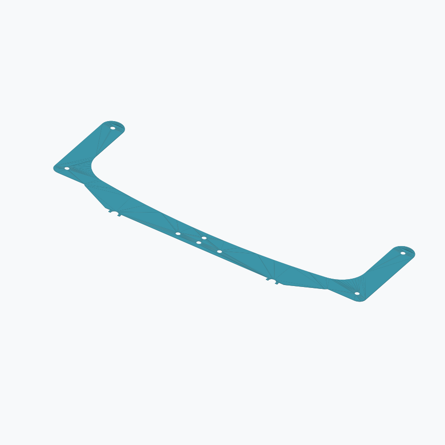
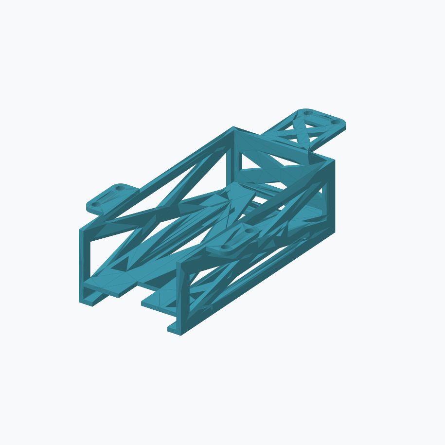
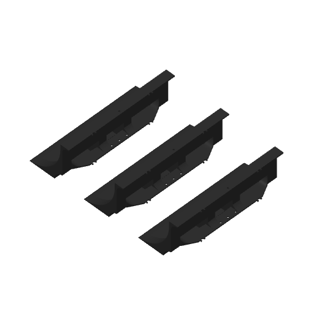
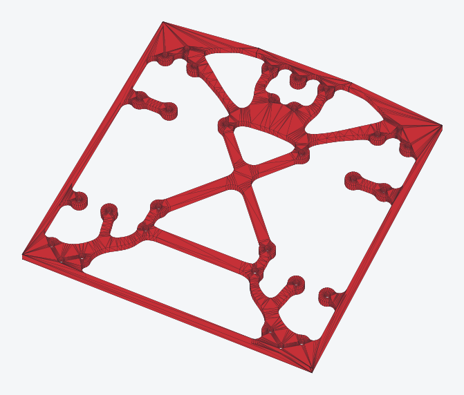

# WRG Mass Printing — Bambu Studio print files

Working print files and public model releases for the WRG robotics team. Check each file’s status below.

WRG 機器人團隊的列印工作檔案與公開模型發佈；請參閱下方各檔案的狀態。

## 2026 WRG KCIS-XG Public Release

[Download the special public release](https://github.com/Kowls0419/WRG-MASS-PRINTING/releases/tag/2026-wrg-kcis-xg-public) · [Models and documentation](public-release/) · [Custom .3mf print configurations](public-release/print-configs/)

MIT-licensed motor stand, bottom board, ball intake top, ball intake bottom, and standard battery box. Includes single-part STL files and **STL → STEP conversions**. The public collection now also includes stronger 3 mm / 5 mm intake pockets and supplied H2C/P2S projects; earlier 2 mm funnels remain historical.

採用 MIT 授權公開馬達支架、底板、吃求口（之後提供）的上片與下片與電池匣，包含單一零件 STL 與 **STL → STEP 轉換檔案**。公開合集亦收錄新版加厚 3 mm／5 mm 吃球口口袋與提供的 H2C／P2S 專案；舊版 2 mm 漏斗保留作為歷史版本。

**The updated public ZIP contains 13 `.3mf` projects, including the three new intake-pocket projects.**

**更新後公開 ZIP 包含 13 個 `.3mf` 專案，其中包括三個新版吃球口口袋專案。**

## Stronger intake pockets — 2026-11-11 / 加厚吃球口口袋 — 2026-11-11

Kyle reported that the previous 2 mm top and two-bottom funnel arrangement was too weak. Use these supplied 3 mm mid and 5 mm bottom pockets for the revised design. The earlier funnel files remain available as historical versions; strength of the new parts has not yet been recorded here.

Kyle 回報先前 2 mm 上片搭配兩片下片的吃球口配置強度不足。新版設計改用此次提供的 3 mm 中層口袋與 5 mm 底層口袋。舊版漏斗檔案保留作為歷史版本；此處尚未記錄新版零件的強度測試結果。

| Part / 零件 | Preview / 預覽 | Dimensions / 尺寸 (mm) | STL | STEP |
|---|---|---|---|---|
| 3 mm mid intake pocket / 3 mm 中層吃球口口袋 |  | 225 × 85.7 × 3 | [STL](public-release/stl/intake-pocket-mid-3mm.stl) | [STEP](public-release/step/intake-pocket-mid-3mm.step) |
| 5 mm bottom intake pocket / 5 mm 底層吃球口口袋 |  | 225 × 87.2 × 5 | [STL](public-release/stl/intake-pocket-bottom-5mm.stl) | [STEP](public-release/step/intake-pocket-bottom-5mm.step) |

The STEP files are faceted solids converted from the supplied STL meshes, with coplanar faces merged; they do not restore parametric CAD history. Each STEP was reimported and checked as one valid solid with matching dimensions and volume.

STEP 檔案由提供的 STL 網格轉為面片實體，並合併共平面面片，未還原參數化 CAD 建模歷程。兩個 STEP 均重新匯入，確認為單一有效實體，且尺寸與體積符合 STL。

### Supplied print projects / 提供的列印專案

All three projects preserve the supplied settings and geometry byte for byte: 0.2 mm layers, four walls, 5/3 top/bottom shells, 15% infill. Check the selected hardware and filament in Studio before printing.

三個專案完整保留原始設定與模型：0.2 mm 層高、四道牆、上／下殼層 5／3 層、15% 填充。列印前請在 Studio 確認所選設備與耗材。

| Printer / 印表機 | Part / 零件 | Nozzle / 噴嘴 | Filament / 耗材 | Parts per plate / 每盤零件數 | Project / 專案 |
|---|---|---|---|---|---|
| H2C | 5 mm bottom / 5 mm 底層 | 0.4 SF | Red Bambu PETG Basic / 紅色 Bambu PETG Basic | 1 | [h2c-intake-pocket-bottom-5mm-red.3mf](H2C/h2c-intake-pocket-bottom-5mm-red.3mf) |
| H2C | 3 mm mid / 3 mm 中層 | 0.4 SF | Black Bambu PETG Basic / 黑色 Bambu PETG Basic | 1 | [h2c-intake-pocket-mid-3mm-black.3mf](H2C/h2c-intake-pocket-mid-3mm-black.3mf) |
| P2S | 3 mm mid / 3 mm 中層 | 0.4 HF | Black Generic PETG / 黑色 Generic PETG | 4 | [p2s-intake-pocket-mid-3mm-black.3mf](P2S/p2s-intake-pocket-mid-3mm-black.3mf) |

### Part previews / 零件預覽

| Part / 零件 | Preview / 預覽 |
|---|---|
| Motor stand / 馬達支架 |  |
| Bottom board / 底板 |  |
| Ball intake top / 吃求口（之後提供）—上片 |  |
| Ball intake bottom / 吃求口（之後提供）—下片 |  |
| Standard battery box / 電池匣 |  |
| Sumo / 相撲機器人零件 |  [H2C .3mf](H2C/FinalSumo.3mf) |
| New bottom board / 新版底板 |  [H2C .3mf](H2C/new%20board.3mf) |
| 3 mm mid intake pocket / 3 mm 中層吃球口口袋 |  [STL](public-release/stl/intake-pocket-mid-3mm.stl) · [STEP](public-release/step/intake-pocket-mid-3mm.step) · [H2C .3mf](H2C/h2c-intake-pocket-mid-3mm-black.3mf) · [P2S .3mf](P2S/p2s-intake-pocket-mid-3mm-black.3mf) |
| 5 mm bottom intake pocket / 5 mm 底層吃球口口袋 |  [STL](public-release/stl/intake-pocket-bottom-5mm.stl) · [STEP](public-release/step/intake-pocket-bottom-5mm.step) · [H2C .3mf](H2C/h2c-intake-pocket-bottom-5mm-red.3mf) |

## ⬇️ How to get your files

- **Easiest:** go to **[Releases → Latest](../../releases/latest)** and download the matching `.3mf` from *Assets*. Choose your printer owner and filament; the latest release contains the KY 0.4 HF grey funnel-bottom project. H2C Sumo and new bottom-board files are in the [bilingual public release](https://github.com/Kowls0419/WRG-MASS-PRINTING/releases/tag/2026-wrg-kcis-xg-public).
- **Always-newest single file:** open your folder below → click the file → **Download raw file** (↓ icon).
- **What changed:** open a file → **History**.

Open the `.3mf` in Bambu Studio, check the plate/filament match your printer, slice, and print. **Slice and send without saving** — saving in Studio wipes the file's list of overridden settings.

## Lightweight topboard — 60 bots

**[Download the latest topboard-only release](https://github.com/Kowls0419/WRG-MASS-PRINTING/releases/tag/2026-10-19)** · [Files and printing quantities](Topboard-README.md) — KY, TC and JL versions in **white JP PETG or official Bambu PETG Basic**. Supplied 150 × 160 × 2 mm geometry, bottom-board process settings, one per plate; 60 boards total.

## KY funnel bottom — 2026-10-31

[Download the 0.4 HF grey funnel-bottom release](https://github.com/Kowls0419/WRG-MASS-PRINTING/releases/tag/2026-10-31) — P2S, JP PETG Grey, four per plate, about 1 h 58 min / 39.2 g. Flow capped at 12 mm³/s; physical test pending.

## Previous printing release — 2026-10-16

**[Download TC’s funnel bottom](https://github.com/Kowls0419/WRG-MASS-PRINTING/releases/tag/2026-10-16)** — X2D 0.8 HF left nozzle, JP PETG Grey, four copies per plate, ~55 min / 48 g. The release contains only the .3mf file.

## Corrected funnel top release — 2026-10-14

**[Download the new release: all six corrected tops](https://github.com/Kowls0419/WRG-MASS-PRINTING/releases/tag/2026-10-14)** · [Guide](FunnelTop-Corrected-README.md) — white JP PETG or official Bambu PETG Basic, four interleaved copies per plate. These replace the previous wrong top mesh. Earlier releases retain that superseded geometry; use this guide for the current funnel top.

## Previous printing release — 2026-10-10

[Download the current three-file release](https://github.com/Kowls0419/WRG-MASS-PRINTING/releases/tag/2026-10-10): **JL funnel top, KY funnel bottom, TC adapter**. All three .3mf files are in the ZIP and available individually.

## Current printing assignments

| Printer owner | Part | File |
|---|---|---|
| JL | Funnel top | [JL-FunnelTop](JL/JL-FunnelTop_P2S_0.6HF_TexturedPEI_JPPETG.3mf) |
| KY | Funnel bottom | [KY-FunnelBottom](KY/KY-FunnelBottom_P2S_0.8HF_TexturedPEI_JPPETG.3mf) |
| TC | Funnel bottom | [TC-FunnelBottom](TC/TC-FunnelBottom_X2D_0.8HF_TexturedPEI_JPPETG.3mf) — 4 copies, JP PETG Grey |

## KY (Kyle)

| File | Printer / nozzle | Filament | Plate | Layer / walls / shells / infill | Max flow | Copies | Status |
|---|---|---|---|---|---|---|---|
| [`KY-FinalBottom_P2S_0.8HF_TexturedPEI_JPPETG.3mf`](KY/KY-FinalBottom_P2S_0.8HF_TexturedPEI_JPPETG.3mf) | P2S 0.8 HF | JP PETG | Textured PEI 65°C | 0.3 / 3 / 3-3 / 7% | 28 | 1 | ✅ mass printing — flow 28 not yet test-printed |
| [`KY-Topboard-Lightweight_P2S_0.8HF_TexturedPEI_BambuPETG.3mf`](KY/KY-Topboard-Lightweight_P2S_0.8HF_TexturedPEI_BambuPETG.3mf) | P2S 0.8 HF | Bambu PETG Basic White | Textured PEI 70°C | 0.3 / 3 / 3-3 / 7% | 23 HF | 1 | New lightweight topboard for 60 bots; bottom-board process, first layer 0.2 mm. ~42 min / 31.1 g. [Guide](Topboard-README.md) |
| [`KY-Topboard-Lightweight_P2S_0.8HF_TexturedPEI_JPPETG.3mf`](KY/KY-Topboard-Lightweight_P2S_0.8HF_TexturedPEI_JPPETG.3mf) | P2S 0.8 HF | JP PETG White | Textured PEI 65°C | 0.3 / 3 / 3-3 / 7% | 28 | 1 | New lightweight topboard for 60 bots; bottom-board process, first layer 0.2 mm. ~40 min / 31.6 g. [Guide](Topboard-README.md) |
| [`KY-motorstand_P2S_0.8HF_TexturedPEI_JPPETG.3mf`](KY/KY-motorstand_P2S_0.8HF_TexturedPEI_JPPETG.3mf) | P2S 0.8 HF | JP PETG Grey | Textured PEI 65°C | 0.3 / 3 / 3-3 / 20% | 28 | 36 | Grey 0.8 HF version; original 36-copy motor-stand layout. Walls 2.46 mm, shells 0.9 mm. First layer 0.3 mm. ~7 h 32 min / 396.5 g |
| [`KY-FunnelTop_P2S_0.8HF_TexturedPEI_JPPETG.3mf`](KY/KY-FunnelTop_P2S_0.8HF_TexturedPEI_JPPETG.3mf) | P2S 0.8 HF | JP PETG White | Textured PEI 65°C | 0.3 / 3 / 3-3 / 7% | 28 | 4 | **Corrected top mesh — 2026-10-13.** White, four interleaved copies using KY JP layout, ~48 min / 38.3 g. [Guide](FunnelTop-Corrected-README.md) |
| [`KY-FunnelTop_P2S_0.8HF_TexturedPEI_BambuPETG.3mf`](KY/KY-FunnelTop_P2S_0.8HF_TexturedPEI_BambuPETG.3mf) | P2S 0.8 HF | Bambu PETG Basic White | Textured PEI 70°C | 0.3 / 3 / 3-3 / 7% | 23 HF | 4 | **Corrected top mesh — 2026-10-13.** White, four interleaved copies using KY JP layout, ~51 min / 37.7 g. [Guide](FunnelTop-Corrected-README.md) |
| [`KY-BatTop-Standard_P2S_0.8HF_TexturedPEI_JPPETG.3mf`](KY/KY-BatTop-Standard_P2S_0.8HF_TexturedPEI_JPPETG.3mf) | P2S 0.8 HF | JP PETG | Textured PEI 70°C | adaptive 0.16–0.56 / 3 / 2-2 / 7% | 28 | 12 | ✅ mass printing (60 needed = 5 plates) — **verified Standard mesh**, standing on end, settings from TEST3: Tree Slim (top Z 0.3 / XY 0.4), anti-sway speeds, seam fix, auto brim 5 mm. ✅ **12-copy plate test-printed successfully (2026-10-04)** |
| [`KY-BatTop-Standard_P2S_0.8HF_TexturedPEI_BambuPETG.3mf`](KY/KY-BatTop-Standard_P2S_0.8HF_TexturedPEI_BambuPETG.3mf) | P2S 0.8 HF | Bambu PETG Basic Yellow | Textured PEI 70°C | adaptive 0.16–0.56 / 3 / 2-2 / 7% | 21 | 12 | Same as KY BatTop Standard (12 standing copies) but with the **official Bambu PETG Basic 0.8 profile**: 250/245 °C, retraction 0.4, max flow 21, fan max 60%. Not yet test-printed |
| [`KY-FunnelBottom_P2S_0.4HF_TexturedPEI_JPPETG.3mf`](KY/KY-FunnelBottom_P2S_0.4HF_TexturedPEI_JPPETG.3mf) | P2S 0.4 HF | JP PETG Grey | Textured PEI 65°C | 0.2 / 4 / 3-2 / 7% | 12 | 4 | New 0.4 HF version; CLI slice passed, ~1 h 58 min / 39.2 g. Physical test pending |
| [`KY-FunnelBottom_P2S_0.8HF_TexturedPEI_JPPETG.3mf`](KY/KY-FunnelBottom_P2S_0.8HF_TexturedPEI_JPPETG.3mf) | P2S 0.8 HF | JP PETG Grey | Textured PEI 65°C | 0.3 / 3 / 3-3 / 7% | 28 | 4 | ▶️ currently printing — funnel bottom, 4 per plate, grey JP PETG |

## JL (Justin)

| File | Printer / nozzle | Filament | Plate | Layer / walls / shells / infill | Max flow | Copies | Status |
|---|---|---|---|---|---|---|---|
| [`JL-motorstand_P2S_0.4SF_TexturedPEI_BambuPETG.3mf`](JL/JL-motorstand_P2S_0.4SF_TexturedPEI_BambuPETG.3mf) | P2S 0.4 SF | Bambu PETG Basic Black | Textured PEI 70°C | 0.2 / 6 / 5-5 / 20% | 15 | 36 | ✅ ready — official Bambu PETG Basic 0.4 filament profile; converted from the 0.6 HF motorstand (same wall/shell thickness), 383 g / ~12 h 27 m, not yet test-printed at 0.4mm |
| [`JL-Topboard-Lightweight_P2S_0.6HF_TexturedPEI_BambuPETG.3mf`](JL/JL-Topboard-Lightweight_P2S_0.6HF_TexturedPEI_BambuPETG.3mf) | P2S 0.6 HF | Bambu PETG Basic White | Textured PEI 70°C | 0.3 / 4 / 3-3 / 7% | 23 HF | 1 | New lightweight topboard for 60 bots; bottom-board process, first layer 0.2 mm. ~54 min / 32.5 g. [Guide](Topboard-README.md) |
| [`JL-Topboard-Lightweight_P2S_0.6HF_TexturedPEI_JPPETG.3mf`](JL/JL-Topboard-Lightweight_P2S_0.6HF_TexturedPEI_JPPETG.3mf) | P2S 0.6 HF | JP PETG White | Textured PEI 65°C | 0.3 / 4 / 3-3 / 7% | 28 | 1 | New lightweight topboard for 60 bots; bottom-board process, first layer 0.2 mm. ~52 min / 33.0 g. [Guide](Topboard-README.md) |
| [`JL-FunnelTop_P2S_0.6HF_TexturedPEI_JPPETG.3mf`](JL/JL-FunnelTop_P2S_0.6HF_TexturedPEI_JPPETG.3mf) | P2S 0.6 HF | JP PETG White | Textured PEI 65°C | 0.3 / 4 / 3-3 / 7% | 28 | 4 | **Corrected top mesh — 2026-10-13.** White, four interleaved copies using KY JP layout, ~65 min / 42.1 g. [Guide](FunnelTop-Corrected-README.md) |
| [`JL-FunnelTop_P2S_0.6HF_TexturedPEI_BambuPETG.3mf`](JL/JL-FunnelTop_P2S_0.6HF_TexturedPEI_BambuPETG.3mf) | P2S 0.6 HF | Bambu PETG Basic White | Textured PEI 70°C | 0.3 / 4 / 3-3 / 7% | 23 HF | 4 | **Corrected top mesh — 2026-10-13.** White, four interleaved copies using KY JP layout, ~66 min / 41.5 g. [Guide](FunnelTop-Corrected-README.md) |

## TC (Terry)

| File | Printer / nozzle | Filament | Plate | Layer / walls / shells / infill | Max flow | Copies | Status |
|---|---|---|---|---|---|---|---|
| [`TC-FinalBottom_X2D_0.8HF_TexturedPEI_JPPETG.3mf`](TC/TC-FinalBottom_X2D_0.8HF_TexturedPEI_JPPETG.3mf) | X2D 0.8 HF | JP PETG | Textured PEI 65°C | 0.3 / 3 / 3-3 / 7% | 28 | 1 | ✅ ready — X2D 0.8HF printer preset unverified |
| [`TC-Topboard-Lightweight_X2D_0.8HF_TexturedPEI_BambuPETG.3mf`](TC/TC-Topboard-Lightweight_X2D_0.8HF_TexturedPEI_BambuPETG.3mf) | X2D 0.8 HF | Bambu PETG Basic White | Textured PEI 70°C | 0.3 / 3 / 3-3 / 7% | 23 HF | 1 | New lightweight topboard for 60 bots; bottom-board process, first layer 0.2 mm. ~40 min / 31.1 g. [Guide](Topboard-README.md) |
| [`TC-Topboard-Lightweight_X2D_0.8HF_TexturedPEI_JPPETG.3mf`](TC/TC-Topboard-Lightweight_X2D_0.8HF_TexturedPEI_JPPETG.3mf) | X2D 0.8 HF | JP PETG White | Textured PEI 65°C | 0.3 / 3 / 3-3 / 7% | 28 | 1 | New lightweight topboard for 60 bots; bottom-board process, first layer 0.2 mm. ~38 min / 31.6 g. [Guide](Topboard-README.md) |
| [`TC-FunnelTop_X2D_0.8HF_TexturedPEI_JPPETG.3mf`](TC/TC-FunnelTop_X2D_0.8HF_TexturedPEI_JPPETG.3mf) | X2D 0.8 HF | JP PETG White | Textured PEI 65°C | 0.3 / 3 / 3-3 / 7% | 28 | 4 | **Corrected top mesh — 2026-10-13.** White, four interleaved copies using KY JP layout, ~46 min / 38.3 g. [Guide](FunnelTop-Corrected-README.md) |
| [`TC-FunnelTop_X2D_0.8HF_TexturedPEI_BambuPETG.3mf`](TC/TC-FunnelTop_X2D_0.8HF_TexturedPEI_BambuPETG.3mf) | X2D 0.8 HF | Bambu PETG Basic White | Textured PEI 70°C | 0.3 / 3 / 3-3 / 7% | 23 HF | 4 | **Corrected top mesh — 2026-10-13.** White, four interleaved copies using KY JP layout, ~49 min / 37.7 g. [Guide](FunnelTop-Corrected-README.md) |
| [`TC-FunnelBottom_X2D_0.8HF_TexturedPEI_JPPETG.3mf`](TC/TC-FunnelBottom_X2D_0.8HF_TexturedPEI_JPPETG.3mf) | X2D 0.8 HF | JP PETG Grey | Textured PEI 65°C | 0.3 / 3 / 3-3 / 7% | 28 | 4 | Released 2026-10-16 — four per plate, previous funnel mass-print settings, left 0.8 HF nozzle. ~55 min / 48 g |
| [`TC-Converter_X2D_0.8HF_TexturedPEI_JPPETG.3mf`](TC/TC-Converter_X2D_0.8HF_TexturedPEI_JPPETG.3mf) | X2D 0.8 HF | JP PETG Black | Textured PEI 65°C | 0.3 / 3 / 3-1 / 7% | 28 | 9 | ▶️ assigned to TC — full 3×3 plate, first layer 0.2 mm, original speeds (top surface 80 mm/s), left extruder. ~1 h 55 min / 94 g |

## P2S

[P2S intake-pocket projects and previews / P2S 吃球口口袋專案與預覽](P2S/) — 3 mm mid pocket, black PETG, four per plate.

## H2C

| File | Printer / nozzle | Filament | Plate | Layer / walls / shells / infill | Copies | Status |
|---|---|---|---|---|---|---|
| [FinalSumo.3mf](H2C/FinalSumo.3mf) | H2C 0.4 SF | Bambu PETG Basic Black | Textured PEI 70°C | 0.2 / 2 / 5-3 / 15% | 3 | Original supplied Sumo project; [preview and guide](H2C/) |
| [new board.3mf](H2C/new%20board.3mf) | H2C 0.4 SF | Bambu PETG Basic Red | Textured PEI 70°C | 0.2 / 4 / 5-3 / 7% | 4 | Original supplied new bottom-board project; [preview and guide](H2C/) |

## 🧪 WIP — being tested, don't print yet

| File | Printer / nozzle | Filament | Plate | Layer / walls / shells / infill | Max flow | Copies | Status |
|---|---|---|---|---|---|---|---|
| [`KY-BatTop-Standard-TEST3_P2S_0.8HF_TexturedPEI_JPPETG.3mf`](WIP/KY-BatTop-Standard-TEST3_P2S_0.8HF_TexturedPEI_JPPETG.3mf) | P2S 0.8 HF | JP PETG | Textured PEI 70°C | 0.3 / 3 / 2-2 / 7% | 28 | 6 | 🧪 **STANDARD BatTop (verified mesh, 60 needed)**. 64 × 115 × 34 mm. **3 plates, by layer:** plate 1 = one flat upside-down copy (34 mm) + one standing (115 mm); plate 2 = 3 standing copies; plate 3 = 1 standing copy with **adaptive layer height (0.16–0.56 mm)**. **Standing won the first test** (supports came off easily). Supports now tuned for standing: Tree Slim, expansion 0, interface spacing 0.8, top Z 0.3 (1 layer) / XY 0.4, on part layers. No layer-range rules, seam fix, auto brim 5 mm. **Anti-sway:** accel 2000 / outer wall 1000 / travel 2500, travel 300 mm/s, walls 80 outer / 120 inner, spiral Z-hop |
| [`KY-BatTop-SpecialEd-TEST2_P2S_0.8HF_TexturedPEI_JPPETG.3mf`](WIP/KY-BatTop-SpecialEd-TEST2_P2S_0.8HF_TexturedPEI_JPPETG.3mf) | P2S 0.8 HF | JP PETG | Textured PEI 70°C | 0.3 / 3 / 2-2 / 7% | 28 | 1 | 🧪 **SPECIAL edition BatTop**. 64 × 99.5 × 34 mm, vertical, Tree Hybrid, seam fix (formerly named Standard-TEST2) |
| [`JL-BatTop-Standard-SINGLE_P2S_0.6HF_TexturedPEI_JPPETG.3mf`](WIP/JL-BatTop-Standard-SINGLE_P2S_0.6HF_TexturedPEI_JPPETG.3mf) | P2S 0.6 HF | JP PETG Yellow | Textured PEI 70°C | 0.3 / 4 / 2-2 / 7% | 28 | 1 | 🧪 one-time single Standard battery box; standing, Tree Slim supports, Outer brim only 5 mm (gap 0.1 mm), KY seam/support settings and Spiral Lift. Fixed 0.3 mm layers / 0.2 mm first layer. ~2 h 12 min / 30.5 g |
| [`JL-BatTop-Standard_P2S_0.4SF_TexturedPEI_JPPETG.3mf`](WIP/JL-BatTop-Standard_P2S_0.4SF_TexturedPEI_JPPETG.3mf) | P2S 0.4 SF | JP PETG Yellow | Textured PEI 70°C | 0.2 / 6 / 3-3 / 7% | 12 | 12 | 🧪 not released yet — **verified Standard mesh**, 12 standing copies, KY's tested settings scaled to 0.4 (Tree Slim top Z 0.2 / XY 0.4, anti-sway, seam fix). 330 g, ~36 h 17 m at fixed 0.2 layers; **add Adaptive layer height in Studio**. Not yet test-printed at 0.4 |

| [`KY-Converter-TEST1_P2S_0.8HF_TexturedPEI_JPPETG.3mf`](WIP/KY-Converter-TEST1_P2S_0.8HF_TexturedPEI_JPPETG.3mf) | P2S 0.8 HF | JP PETG Black | Textured PEI 65°C | 0.3 / 3 / 3-1 / 7% | 28 | 1 | 🧪 **Print this one first:** Converter / ESP 安裝轉接板, 80 × 74.955 × 2 mm. Flat, no supports/brim. First layer 0.3 mm; top surface 40 mm/s; revised after surface-gap feedback. ~21 min / 11.1 g; check ESP and battery-box fit. [Guide](WIP/Converter-README.md) |
| [`TC-Converter-TEST5_X2D_0.8HF_TexturedPEI_JPPETG.3mf`](WIP/TC-Converter-TEST5_X2D_0.8HF_TexturedPEI_JPPETG.3mf) | X2D 0.8 HF | JP PETG Black | Textured PEI 65°C | 0.3 / 3 / 3-1 / 7% | 28 | 5 | 🧪 TC five-piece fit test. Same geometry; X2D-specific settings and left extruder mapping. ~1 h 6 min / 52 g |
| [`KY-Converter-MASS-DRAFT_P2S_0.8HF_TexturedPEI_JPPETG.3mf`](WIP/KY-Converter-MASS-DRAFT_P2S_0.8HF_TexturedPEI_JPPETG.3mf) | P2S 0.8 HF | JP PETG Black | Textured PEI 65°C | 0.3 / 3 / 3-1 / 7% | 28 | 9 | 🧪 **Draft — wait for fit-test approval.** 3×3 layout, 3 mm gaps, by layer; first layer 0.3 mm; top surface 40 mm/s. ~2 h 11 min / 99.5 g |

## Archive

- 2026-10-02: all other WIP files moved to [`archive/`](archive): the 3 BatTop weight tests, the wrong-mesh KY + JL BatTop Standard, TEST1, the old JL SpecialEd 0.4 SF file, KY-Body2 and `BatTop for standard.stl` (the SpecialEd mesh).
- `KY/archive/KY-motorstand_P2S_0.6HF_TexturedPEI_JPPETG.3mf` — retired from active printing 2026-09-30.
- `JL/archive/JL-motorstand_P2S_0.6HF_SuperTack_BambuPETG.3mf` — replaced by the 0.4 SF (Bambu PETG Basic black) version 2026-09-30.

Old baselines and the abandoned stack-printing (PLA interface) experiments are in [`archive/`](archive).

## Notes

- Name format: `OWNER-Part_Printer_Nozzle_Plate_Filament.3mf` — `SF` = standard-flow nozzle, `HF` = high-flow.
- Every file has a built-in process preset that matches its settings exactly, so Studio shows no orange "modified" values. If you see orange, you or Studio changed something: slice and send without saving.
- PETG on 0.6/0.8 HF nozzles is capped at 28 mm³/s max volumetric flow; 0.4 standard nozzles stay at 12–15.

## Single-part STL collection

- 2026-10-09: [`Original STLs/`](Original%20STLs/) contains the six current parts and five archived revisions, with 17 experimental pieces in its `Experimental/` subfolder. Extracted and deduplicated across all 78 source files; provenance and dimensions are recorded inside the folder.
