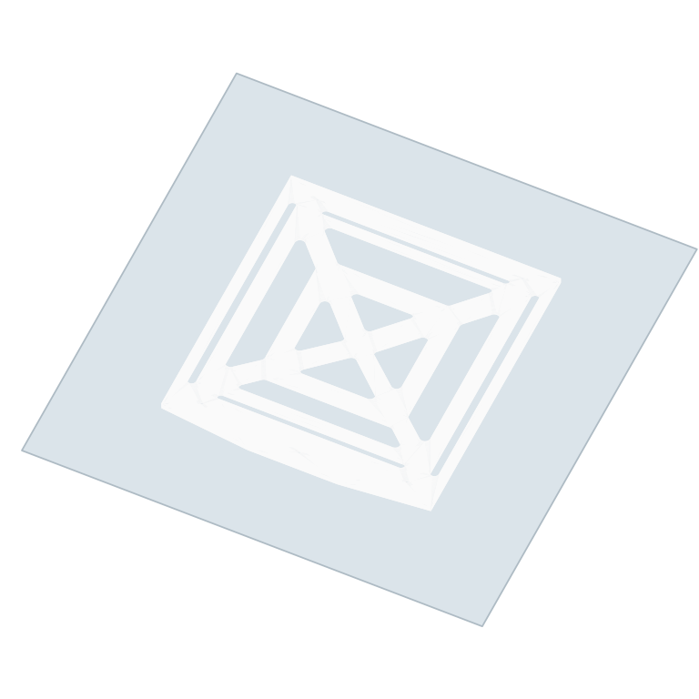

# Lightweight topboard — 60 bots

**[Download the latest topboard release](https://github.com/Kowls0419/WRG-MASS-PRINTING/releases/tag/2026-10-19)** — only the three KY, TC and JL .3mf projects.

Three white **official Bambu PETG Basic** projects made from Kyle’s `topboard.3mf`. The supplied board geometry and holes are preserved: **150 × 160 × 2 mm**. One board per plate, centered and flat on Textured PEI.

| Owner | Printer / nozzle | File | Per-board estimate |
|---|---|---|---|
| KY | P2S 0.8 HF | [KY-Topboard-Lightweight_P2S_0.8HF_TexturedPEI_BambuPETG.3mf](KY/KY-Topboard-Lightweight_P2S_0.8HF_TexturedPEI_BambuPETG.3mf) | ~42 min / 31.1 g |
| TC | X2D 0.8 HF | [TC-Topboard-Lightweight_X2D_0.8HF_TexturedPEI_BambuPETG.3mf](TC/TC-Topboard-Lightweight_X2D_0.8HF_TexturedPEI_BambuPETG.3mf) | ~40 min / 31.1 g |
| JL | P2S 0.6 HF | [JL-Topboard-Lightweight_P2S_0.6HF_TexturedPEI_BambuPETG.3mf](JL/JL-Topboard-Lightweight_P2S_0.6HF_TexturedPEI_BambuPETG.3mf) | ~54 min / 32.5 g |

## Settings carried over from the bottom board

- KY and TC retain their own FinalBottom print settings. JL uses the KY bottom-board process scaled to its existing P2S 0.6 HF nozzle.
- 0.3 mm layers, 0.2 mm first layer, 3 top / 3 bottom shells, 7% infill. Flat, by layer; no supports or brim.
- KY/TC: 3 walls × 0.82 mm = **2.46 mm**. JL: 4 walls × 0.62 mm = **2.48 mm**. Shell thickness target remains **0.9 mm** (the first layer is 0.2 mm).
- Bottom-board process speeds retained. TC’s process values are mapped by the exact extruder ID and named variant; printer hardware, retraction and gcode remain those of the current TC X2D configuration. Filament 1 uses the left 0.8 HF nozzle.
- Official Bambu PETG Basic profiles: **250°C nozzle / 245°C first layer**, **70°C Textured PEI**, **23 mm³/s High Flow limit**. All projects are white.

## Quantity for 60 bots

**60 boards = 60 one-board plates.** For an even split, print 20 plates on each machine:

| Owner | Boards / plates | Estimated print time | Estimated filament |
|---|---|---|---|
| KY | 20 | ~14 h 01 min | ~622 g |
| TC | 20 | ~13 h 26 min | ~622 g |
| JL | 20 | ~17 h 52 min | ~650 g |

Total estimated filament for that split: **1.89 kg**. Times are slicer estimates and exclude handling between plates.

Open the matching project in Bambu Studio, select the white PETG Basic filament, slice and print.

Original source: [Topboard-Lightweight-Source.3mf](models/Topboard-Lightweight-Source.3mf).
