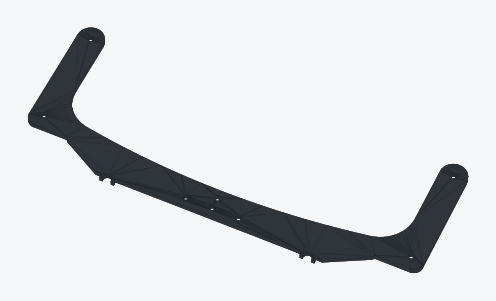
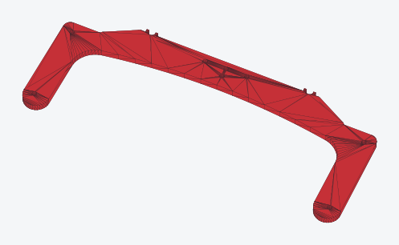
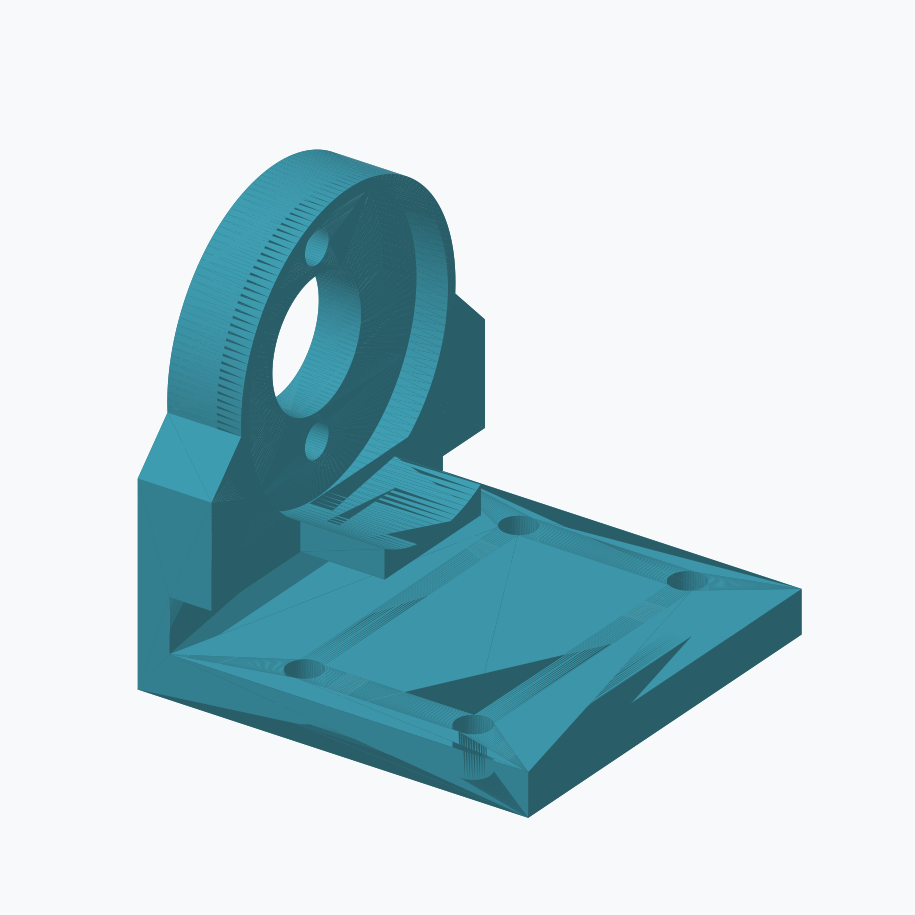
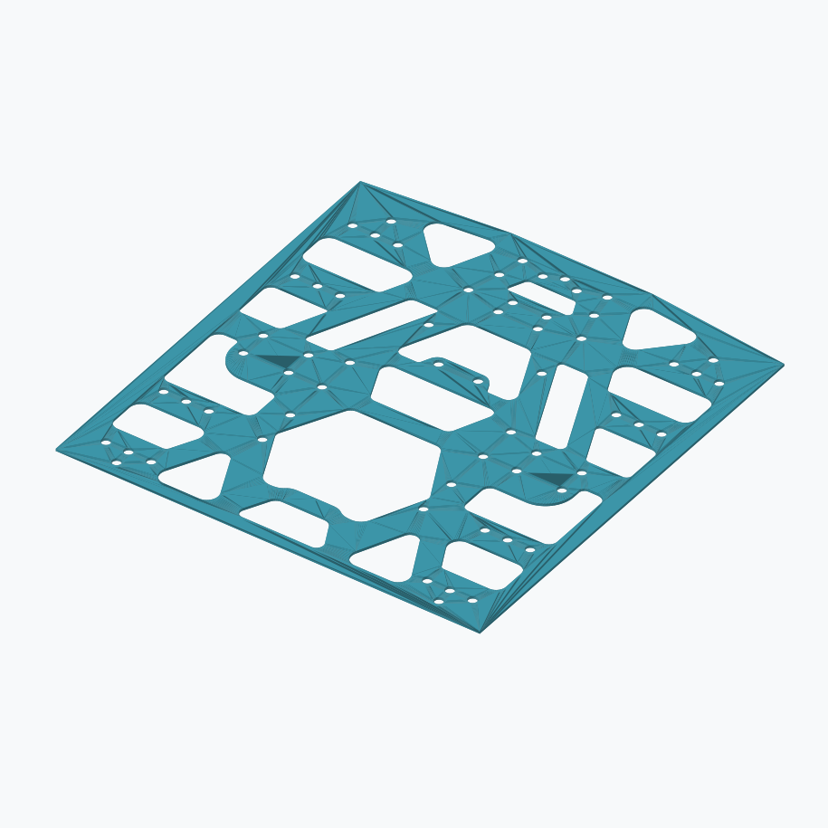
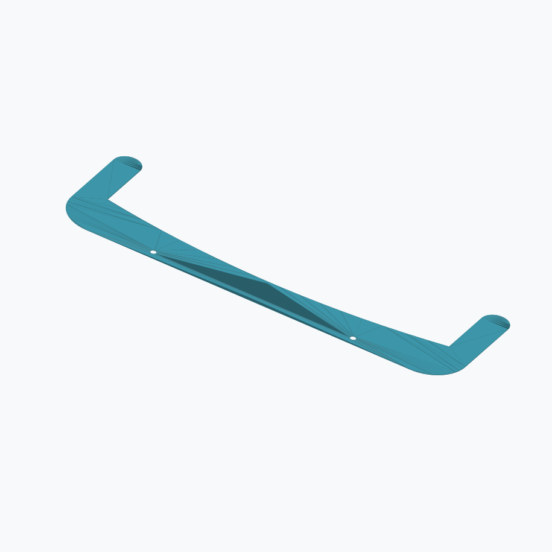
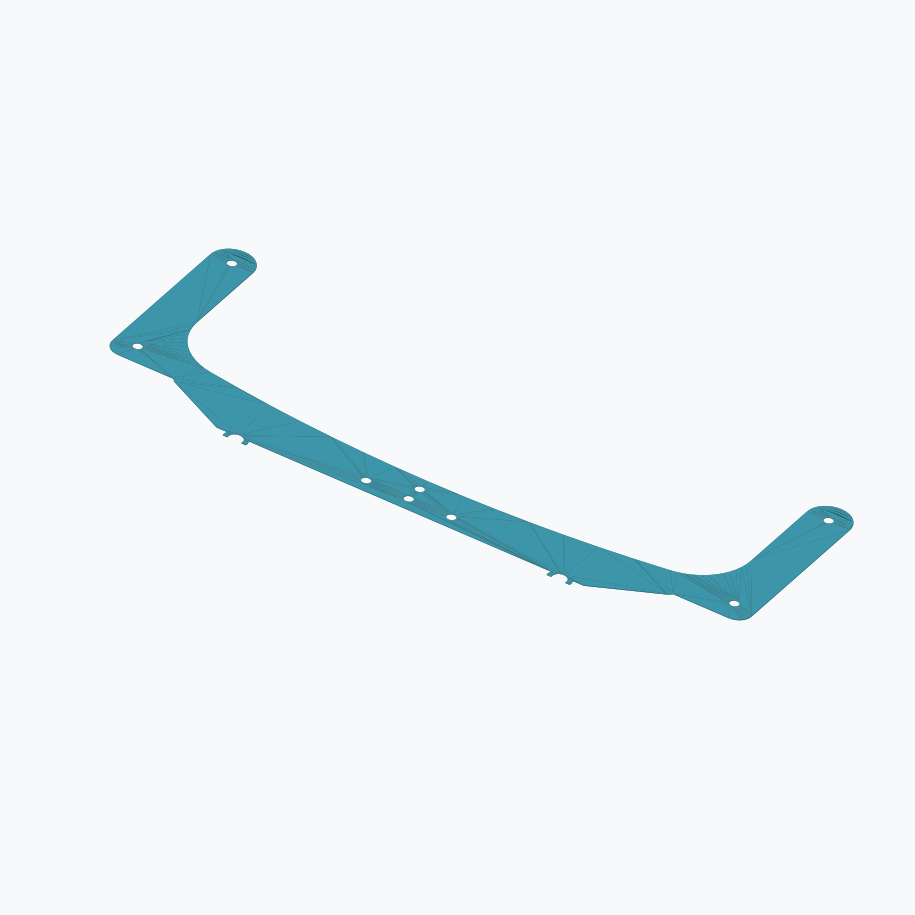
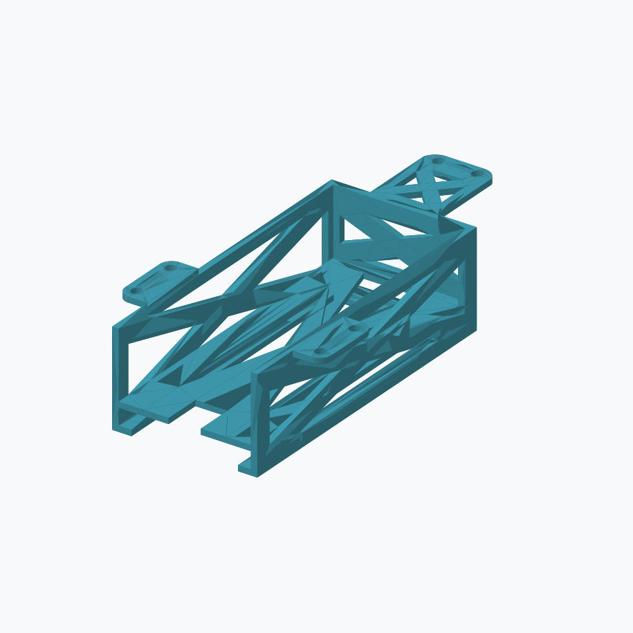
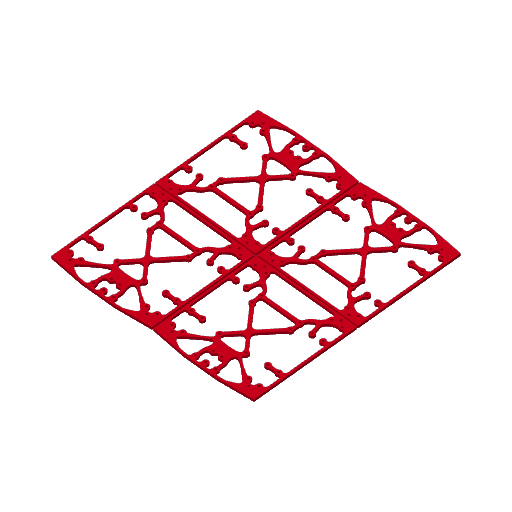

# 2026 WRG KCIS-XG Public Release

Open-source 3D-printable parts from the WRG KCIS-XG team, released under the [MIT License](LICENSE).

WRG KCIS-XG 團隊的開源 3D 列印零件，採用 [MIT 授權條款](LICENSE)公開。

This collection contains the original five-design snapshot plus later H2C projects and the stronger 3 mm / 5 mm intake pockets added on 2026-11-11. The older 2 mm funnel geometry is retained as history.

此合集包含原始五種設計快照、後續 H2C 專案，以及 2026-11-11 新增的加厚 3 mm／5 mm 吃球口口袋。舊版 2 mm 漏斗模型保留作為歷史版本。

## Stronger intake pockets — 2026-11-11 / 加厚吃球口口袋 — 2026-11-11

Kyle reported that the previous 2 mm top and two-bottom funnel arrangement was too weak. Use these supplied 3 mm mid and 5 mm bottom pockets for the revised design. The earlier funnel files remain available as historical versions; strength of the new parts has not yet been recorded here.

Kyle 回報先前 2 mm 上片搭配兩片下片的吃球口配置強度不足。新版設計改用此次提供的 3 mm 中層口袋與 5 mm 底層口袋。舊版漏斗檔案保留作為歷史版本；此處尚未記錄新版零件的強度測試結果。

| Part / 零件 | Preview / 預覽 | Dimensions or plate count / 尺寸 (mm) 或每盤數量 | STL / Project 專案 | STEP |
|---|---|---|---|---|
| 3 mm mid intake pocket / 3 mm 中層吃球口口袋 |  | 225 × 85.7 × 3 | [STL](stl/intake-pocket-mid-3mm.stl) | [STEP](step/intake-pocket-mid-3mm.step) |
| 5 mm bottom intake pocket / 5 mm 底層吃球口口袋 |  | 225 × 87.2 × 5 | [STL](stl/intake-pocket-bottom-5mm.stl) | [STEP](step/intake-pocket-bottom-5mm.step) |

The STEP files are faceted solids converted from the supplied STL meshes, with coplanar faces merged; they do not restore parametric CAD history. Each STEP was reimported and checked as one valid solid with matching dimensions and volume.

STEP 檔案由提供的 STL 網格轉為面片實體，並合併共平面面片，未還原參數化 CAD 建模歷程。兩個 STEP 均重新匯入，確認為單一有效實體，且尺寸與體積符合 STL。

### Supplied print projects / 提供的列印專案

All three projects preserve the supplied settings and geometry byte for byte: 0.2 mm layers, four walls, 5/3 top/bottom shells, 15% infill. Check the selected hardware and filament in Studio before printing.

三個專案完整保留原始設定與模型：0.2 mm 層高、四道牆、上／下殼層 5／3 層、15% 填充。列印前請在 Studio 確認所選設備與耗材。

| Printer / 印表機 | Part / 零件 | Nozzle / 噴嘴 | Filament / 耗材 | Parts per plate / 每盤零件數 | Project / 專案 |
|---|---|---|---|---|---|
| H2C | 5 mm bottom / 5 mm 底層 | 0.4 SF | Red Bambu PETG Basic / 紅色 Bambu PETG Basic | 1 | [h2c-intake-pocket-bottom-5mm-red.3mf](print-configs/H2C/h2c-intake-pocket-bottom-5mm-red.3mf) |
| H2C | 3 mm mid / 3 mm 中層 | 0.4 SF | Black Bambu PETG Basic / 黑色 Bambu PETG Basic | 1 | [h2c-intake-pocket-mid-3mm-black.3mf](print-configs/H2C/h2c-intake-pocket-mid-3mm-black.3mf) |
| P2S | 3 mm mid / 3 mm 中層 | 0.4 HF | Black Generic PETG / 黑色 Generic PETG | 4 | [p2s-intake-pocket-mid-3mm-black.3mf](print-configs/P2S/p2s-intake-pocket-mid-3mm-black.3mf) |

## Part previews and downloads / 零件預覽與下載

Each STL contains one part. Dimensions are in millimetres.

每個 STL 檔案包含一個零件，尺寸單位為毫米。

| Part / 零件 | Preview / 預覽 | Dimensions or plate count / 尺寸 (mm) 或每盤數量 | STL / Project 專案 | STEP |
|---|---|---|---|---|
| Motor stand / 馬達支架 |  | 37 × 37 × 38 | [STL](stl/motor-stand.stl) | [STEP](step/motor-stand.step) |
| Bottom board / 底板 |  | 150 × 158 × 4 | [STL](stl/bottom-board.stl) | [STEP](step/bottom-board.step) |
| Previous 2 mm intake top / 舊版 2 mm 吃球口上片 |  | 225 × 70 × 2 | [STL](stl/funnel-top.stl) | [STEP](step/funnel-top.step) |
| Previous 2 mm intake bottom / 舊版 2 mm 吃球口下片 |  | 225 × 85.7 × 2 | [STL](stl/funnel-bottom.stl) | [STEP](step/funnel-bottom.step) |
| Standard battery box / 電池匣 |  | 64 × 115 × 34 | [STL](stl/battery-box-standard.stl) | [STEP](step/battery-box-standard.step) |
| Sumo / 相撲機器人零件 |  | 3 per plate / 每盤 3 個 | [H2C .3mf](print-configs/H2C/FinalSumo.3mf) | — |
| New bottom board / 新版底板 |  | 4 per plate / 每盤 4 片 | [H2C .3mf](print-configs/H2C/new%20board.3mf) | — |
| 3 mm mid intake pocket / 3 mm 中層吃球口口袋 |  | 225 × 85.7 × 3 | [STL](stl/intake-pocket-mid-3mm.stl) | [STEP](step/intake-pocket-mid-3mm.step) |
| 5 mm bottom intake pocket / 5 mm 底層吃球口口袋 |  | 225 × 87.2 × 5 | [STL](stl/intake-pocket-bottom-5mm.stl) | [STEP](step/intake-pocket-bottom-5mm.step) |

The standard battery box is the 115 mm version, called “BatTop Standard” in the print projects.

電池匣採用 115 mm 版本，在列印專案中稱為「BatTop Standard」。

## Custom print configurations / 自訂列印設定

**The updated ZIP contains 13 `.3mf` projects: the original eight, two earlier H2C additions, and three new intake-pocket projects.**

**更新後 ZIP 的 `print-configs/` 資料夾包含 13 個 `.3mf` 專案：原始八個、先前新增的兩個 H2C 專案，以及三個新版吃球口口袋專案。**

[Open the custom .3mf folder](print-configs/) for Bambu Studio plate layouts and printer/material settings. These are separate from the single-part model files. Use the configuration matching your printer, nozzle, plate, and filament.

[開啟自訂 .3mf 設定資料夾](print-configs/)，取得 Bambu Studio 列印盤配置與印表機／耗材設定。設定檔與單一零件模型分開存放；請選擇符合印表機、噴嘴、列印板及耗材的設定。

## **STL → STEP conversion / STL → STEP 轉換**

**The STEP files are converted from the STL meshes with OpenCascade.** Coplanar faces are merged. Curves retain mesh facets; original sketches, dimensions, and parametric feature history are not recovered. For printing, use the STL or a suitable .3mf project.

**STEP 檔案由 STL 網格透過 OpenCascade 轉換為封閉實體**，並合併共平面面片。曲面仍保留網格面片，未還原原始草圖、尺寸約束或參數化建模歷程。列印時請使用 STL 或適用的 .3mf 專案。

Conversion tooling: [OpenCascade topology documentation](https://dev.opencascade.org/sites/default/files/pdf/Topology.pdf).

轉換工具參考：[OpenCascade 拓撲文件](https://dev.opencascade.org/sites/default/files/pdf/Topology.pdf)。

## Download and reuse / 下載與使用

Individual STL and STEP files are also available as release assets.

發佈附件亦提供個別 STL 與 STEP 檔案下載。

Download the complete ZIP from [2026 WRG KCIS-XG Public Release](https://github.com/Kowls0419/WRG-MASS-PRINTING/releases/tag/2026-wrg-kcis-xg-public). The complete archive includes both model formats, custom print projects, named part previews, documentation, and the MIT license.

請從 [2026 WRG KCIS-XG Public Release](https://github.com/Kowls0419/WRG-MASS-PRINTING/releases/tag/2026-wrg-kcis-xg-public)下載完整 ZIP 壓縮檔。完整壓縮檔包含兩種模型格式、自訂列印專案、附名稱的零件預覽圖、說明文件與 MIT 授權條款。

You may use, modify, and share these files under MIT; include the copyright notice and license when redistributing.

您可依 MIT 授權使用、修改及分享這些檔案；再次散佈時請保留著作權聲明與授權條款。
