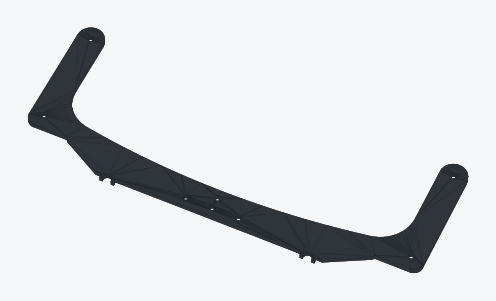
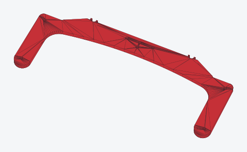
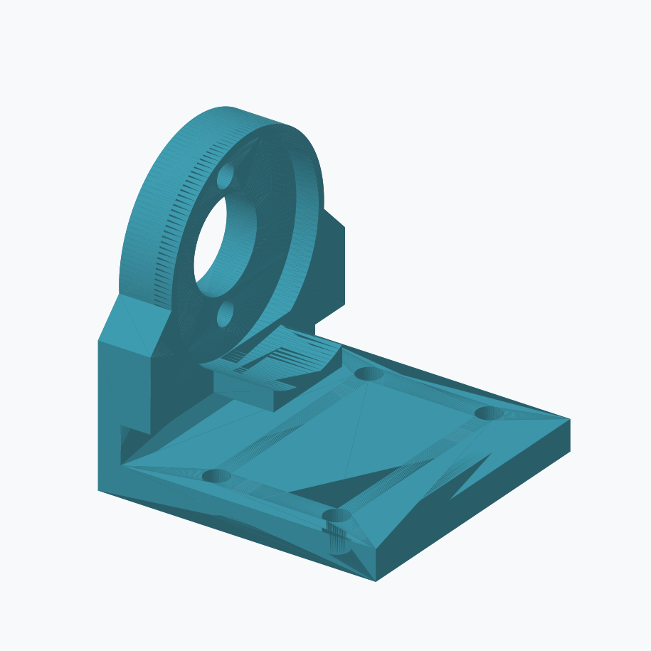
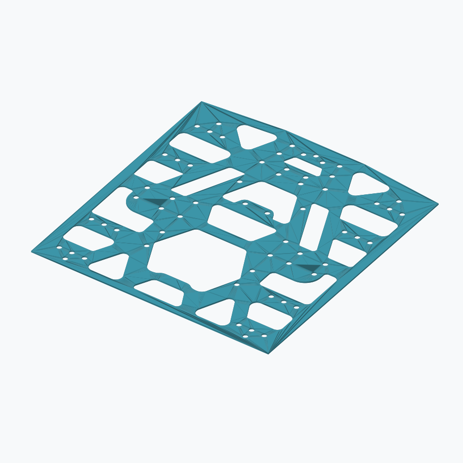
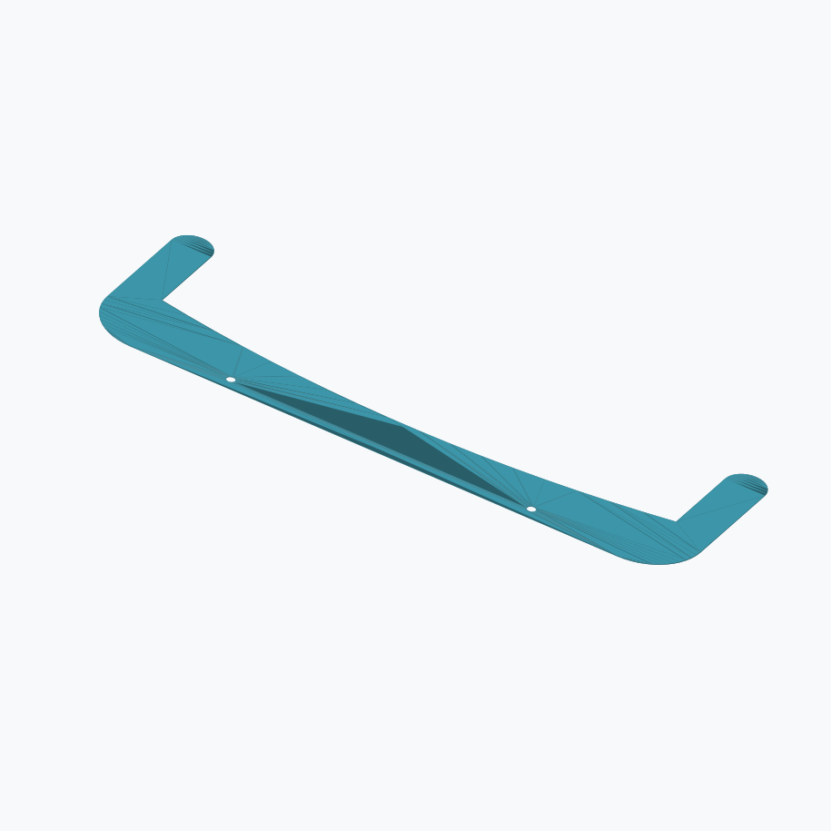
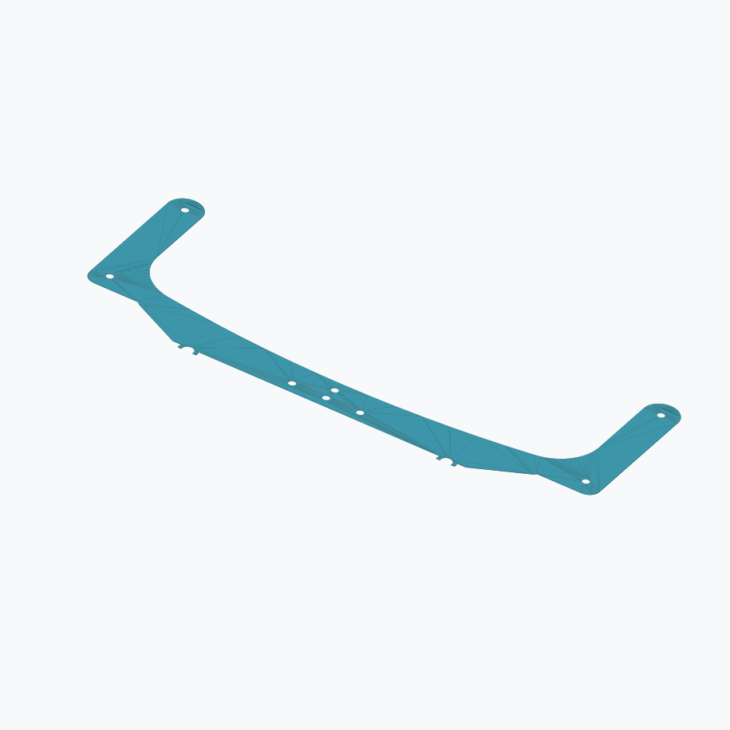
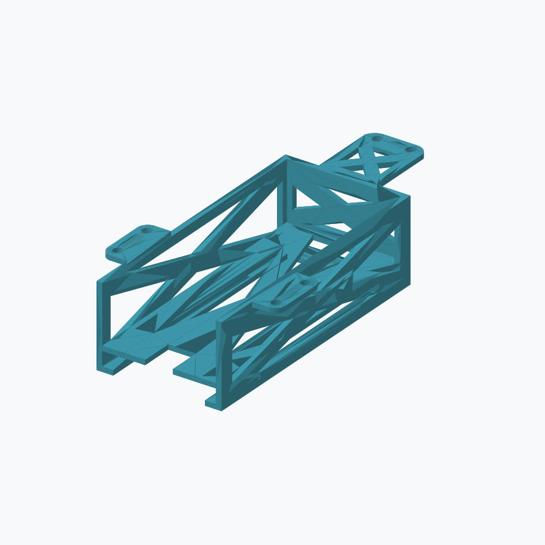
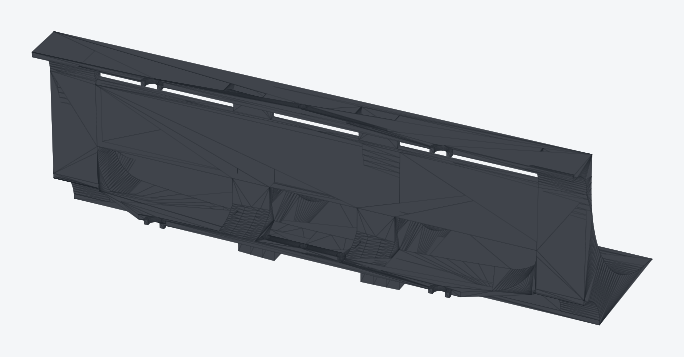
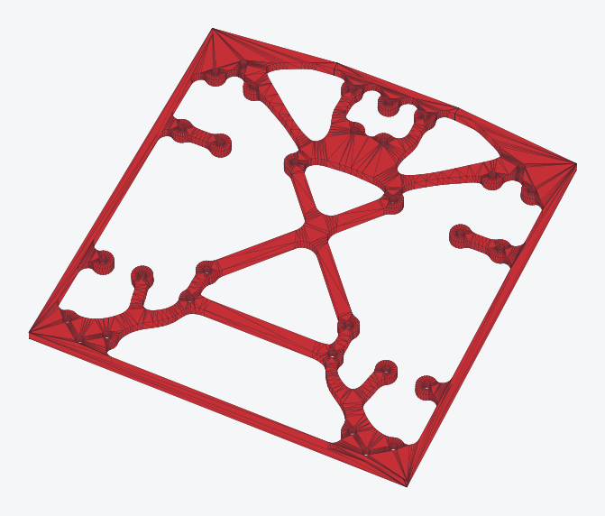

# 2026 WRG KCIS-XG Public Release

MIT-licensed WRG KCIS-XG models and supplied print projects. Updated 2026-11-11 with stronger 3 mm mid / 5 mm bottom intake pockets and three H2C/P2S projects; the original five-design snapshot remains available.

本次發佈以 MIT 授權公開 WRG KCIS-XG 模型與提供的列印專案。2026-11-11 新增加厚 3 mm 中層／5 mm 底層吃球口口袋與三個 H2C／P2S 專案，並保留原始五種設計快照。

## Stronger intake pockets — 2026-11-11 / 加厚吃球口口袋 — 2026-11-11

Kyle reported that the previous 2 mm top and two-bottom funnel arrangement was too weak. Use these supplied 3 mm mid and 5 mm bottom pockets for the revised design. The earlier funnel files remain available as historical versions; strength of the new parts has not yet been recorded here.

Kyle 回報先前 2 mm 上片搭配兩片下片的吃球口配置強度不足。新版設計改用此次提供的 3 mm 中層口袋與 5 mm 底層口袋。舊版漏斗檔案保留作為歷史版本；此處尚未記錄新版零件的強度測試結果。

| Part / 零件 | Preview / 預覽 | Dimensions / 尺寸 (mm) | STL | STEP |
|---|---|---|---|---|
| 3 mm mid intake pocket / 3 mm 中層吃球口口袋 |  | 225 × 85.7 × 3 | [STL](https://github.com/Kowls0419/WRG-MASS-PRINTING/releases/download/2026-wrg-kcis-xg-public/intake-pocket-mid-3mm.stl) | [STEP](https://github.com/Kowls0419/WRG-MASS-PRINTING/releases/download/2026-wrg-kcis-xg-public/intake-pocket-mid-3mm.step) |
| 5 mm bottom intake pocket / 5 mm 底層吃球口口袋 |  | 225 × 87.2 × 5 | [STL](https://github.com/Kowls0419/WRG-MASS-PRINTING/releases/download/2026-wrg-kcis-xg-public/intake-pocket-bottom-5mm.stl) | [STEP](https://github.com/Kowls0419/WRG-MASS-PRINTING/releases/download/2026-wrg-kcis-xg-public/intake-pocket-bottom-5mm.step) |

The STEP files are faceted solids converted from the supplied STL meshes, with coplanar faces merged; they do not restore parametric CAD history. Each STEP was reimported and checked as one valid solid with matching dimensions and volume.

STEP 檔案由提供的 STL 網格轉為面片實體，並合併共平面面片，未還原參數化 CAD 建模歷程。兩個 STEP 均重新匯入，確認為單一有效實體，且尺寸與體積符合 STL。

### Supplied print projects / 提供的列印專案

All three projects preserve the supplied settings and geometry byte for byte: 0.2 mm layers, four walls, 5/3 top/bottom shells, 15% infill. Check the selected hardware and filament in Studio before printing.

三個專案完整保留原始設定與模型：0.2 mm 層高、四道牆、上／下殼層 5／3 層、15% 填充。列印前請在 Studio 確認所選設備與耗材。

| Printer / 印表機 | Part / 零件 | Nozzle / 噴嘴 | Filament / 耗材 | Parts per plate / 每盤零件數 | Project / 專案 |
|---|---|---|---|---|---|
| H2C | 5 mm bottom / 5 mm 底層 | 0.4 SF | Red Bambu PETG Basic / 紅色 Bambu PETG Basic | 1 | [h2c-intake-pocket-bottom-5mm-red.3mf](https://github.com/Kowls0419/WRG-MASS-PRINTING/releases/download/2026-wrg-kcis-xg-public/h2c-intake-pocket-bottom-5mm-red.3mf) |
| H2C | 3 mm mid / 3 mm 中層 | 0.4 SF | Black Bambu PETG Basic / 黑色 Bambu PETG Basic | 1 | [h2c-intake-pocket-mid-3mm-black.3mf](https://github.com/Kowls0419/WRG-MASS-PRINTING/releases/download/2026-wrg-kcis-xg-public/h2c-intake-pocket-mid-3mm-black.3mf) |
| P2S | 3 mm mid / 3 mm 中層 | 0.4 HF | Black Generic PETG / 黑色 Generic PETG | 4 | [p2s-intake-pocket-mid-3mm-black.3mf](https://github.com/Kowls0419/WRG-MASS-PRINTING/releases/download/2026-wrg-kcis-xg-public/p2s-intake-pocket-mid-3mm-black.3mf) |

## Original collection / 原始合集

- Motor stand / 馬達支架 — 37 × 37 × 38 mm
- Bottom board / 底板 — 150 × 158 × 4 mm
- Ball intake top / 吃求口（之後提供）—上片 — 225 × 70 × 2 mm
- Ball intake bottom / 吃求口（之後提供）—下片 — 225 × 85.7 × 2 mm
- Standard battery box / 電池匣 — 64 × 115 × 34 mm

## Downloads / 下載

Download individual **STL** or **STEP** files from Assets below, or download the updated complete ZIP.

您可從下方 Assets 下載個別 **STL** 或 **STEP** 檔案，或下載更新後的完整 ZIP。

**The updated ZIP contains nine STL models, nine converted STEP models, and 13 `.3mf` projects, including all H2C/P2S additions.**

**更新後 ZIP 包含九個 STL 模型、九個轉換後 STEP 模型，以及 13 個 `.3mf` 專案，涵蓋所有 H2C／P2S 新增檔案。**

- `2026-WRG-KCIS-XG-Public-Release.zip` — complete package: nine STL files, nine STEP files, 13 custom .3mf projects, named part previews, English/Traditional Chinese documentation and MIT license.

- `2026-WRG-KCIS-XG-Public-Release.zip`：完整套件，包含九個 STL、九個 STEP、13 個自訂 .3mf 專案、附名稱的零件預覽圖、英文／繁體中文說明與 MIT 授權條款。

[Model guide](https://github.com/Kowls0419/WRG-MASS-PRINTING/tree/main/public-release) · [Custom .3mf print configurations](https://github.com/Kowls0419/WRG-MASS-PRINTING/tree/main/public-release/print-configs)

[模型說明](https://github.com/Kowls0419/WRG-MASS-PRINTING/tree/main/public-release) · [自訂 .3mf 列印設定](https://github.com/Kowls0419/WRG-MASS-PRINTING/tree/main/public-release/print-configs)

**STL → STEP conversion:** STEP files are closed faceted solids converted from STL, with coplanar faces merged. They preserve mesh geometry and do not recover original parametric CAD features. Choose .3mf settings for your actual printer/nozzle/filament and check the slice.

**STL → STEP 轉換：** STEP 檔案由 STL 轉換為封閉面片實體，並合併共平面面片；保留網格幾何，未還原原始參數化 CAD 功能。請依實際印表機、噴嘴及耗材選擇 .3mf 設定，並確認切片結果。

## Individual Sumo and new bottom-board models / Sumo 與新版底板單一零件模型

Added 2026-11-11: each STL and STEP contains one part extracted from its original H2C project. Only translation to the origin was applied; the original project geometry and settings are unchanged. STEP conversions were reimported as single valid solids with matching dimensions and volume.

2026-11-11 新增：各 STL 與 STEP 均為原 H2C 專案中的單一零件，僅平移至原點；原專案模型與設定未更動。STEP 轉換後重新匯入，確認為單一有效實體，且尺寸與體積符合原模型。

- Sumo / 相撲機器人零件 — 213.2 × 81.85 × 77 mm: [STL](https://github.com/Kowls0419/WRG-MASS-PRINTING/releases/download/2026-wrg-kcis-xg-public/sumo.stl) · [STEP](https://github.com/Kowls0419/WRG-MASS-PRINTING/releases/download/2026-wrg-kcis-xg-public/sumo.step)
- New bottom board / 新版底板 — 150 × 158 × 4 mm: [STL](https://github.com/Kowls0419/WRG-MASS-PRINTING/releases/download/2026-wrg-kcis-xg-public/new-bottom-board.stl) · [STEP](https://github.com/Kowls0419/WRG-MASS-PRINTING/releases/download/2026-wrg-kcis-xg-public/new-bottom-board.step)

## H2C additions — 2026-10-31 / H2C 新增檔案 — 2026-10-31

Two additional H2C project files are available as individual Assets. Both use the H2C 0.4 mm PETG settings supplied by Kyle; the original files are unchanged. These additions are also included in the updated ZIP.

新增兩個 H2C 專案檔，可於下方 Assets 個別下載。兩者皆保留 Kyle 提供的 H2C 0.4 mm PETG 設定與原始內容；新增檔案亦包含於更新後 ZIP 中。

- [FinalSumo.3mf](https://github.com/Kowls0419/WRG-MASS-PRINTING/releases/download/2026-wrg-kcis-xg-public/FinalSumo.3mf) — Sumo / 相撲機器人
- [new board.3mf](https://github.com/Kowls0419/WRG-MASS-PRINTING/releases/download/2026-wrg-kcis-xg-public/new.board.3mf) — New bottom board / 新版底板

## Part previews and downloads / 零件預覽與下載

| Motor stand 馬達支架 | Bottom board 底板 | Ball intake top 吃求口上片 （之後提供） | Ball intake bottom 吃求口下片 （之後提供） | Standard battery box 電池匣 |
|---|---|---|---|---|
|  |  |  |  |  |
| [STL](https://github.com/Kowls0419/WRG-MASS-PRINTING/releases/download/2026-wrg-kcis-xg-public/motor-stand.stl) · [STEP](https://github.com/Kowls0419/WRG-MASS-PRINTING/releases/download/2026-wrg-kcis-xg-public/motor-stand.step) | [STL](https://github.com/Kowls0419/WRG-MASS-PRINTING/releases/download/2026-wrg-kcis-xg-public/bottom-board.stl) · [STEP](https://github.com/Kowls0419/WRG-MASS-PRINTING/releases/download/2026-wrg-kcis-xg-public/bottom-board.step) | [STL](https://github.com/Kowls0419/WRG-MASS-PRINTING/releases/download/2026-wrg-kcis-xg-public/funnel-top.stl) · [STEP](https://github.com/Kowls0419/WRG-MASS-PRINTING/releases/download/2026-wrg-kcis-xg-public/funnel-top.step) | [STL](https://github.com/Kowls0419/WRG-MASS-PRINTING/releases/download/2026-wrg-kcis-xg-public/funnel-bottom.stl) · [STEP](https://github.com/Kowls0419/WRG-MASS-PRINTING/releases/download/2026-wrg-kcis-xg-public/funnel-bottom.step) | [STL](https://github.com/Kowls0419/WRG-MASS-PRINTING/releases/download/2026-wrg-kcis-xg-public/battery-box-standard.stl) · [STEP](https://github.com/Kowls0419/WRG-MASS-PRINTING/releases/download/2026-wrg-kcis-xg-public/battery-box-standard.step) |

| Sumo / 相撲機器人零件 | New bottom board / 新版底板 | 3 mm mid intake pocket / 3 mm 中層吃球口口袋 | 5 mm bottom intake pocket / 5 mm 底層吃球口口袋 |
|---|---|---|---|
|  |  |  |  |
| [STL](https://github.com/Kowls0419/WRG-MASS-PRINTING/releases/download/2026-wrg-kcis-xg-public/sumo.stl) · [STEP](https://github.com/Kowls0419/WRG-MASS-PRINTING/releases/download/2026-wrg-kcis-xg-public/sumo.step) [H2C .3mf](https://github.com/Kowls0419/WRG-MASS-PRINTING/releases/download/2026-wrg-kcis-xg-public/FinalSumo.3mf) | [STL](https://github.com/Kowls0419/WRG-MASS-PRINTING/releases/download/2026-wrg-kcis-xg-public/new-bottom-board.stl) · [STEP](https://github.com/Kowls0419/WRG-MASS-PRINTING/releases/download/2026-wrg-kcis-xg-public/new-bottom-board.step) [H2C .3mf](https://github.com/Kowls0419/WRG-MASS-PRINTING/releases/download/2026-wrg-kcis-xg-public/new.board.3mf) | [STL](https://github.com/Kowls0419/WRG-MASS-PRINTING/releases/download/2026-wrg-kcis-xg-public/intake-pocket-mid-3mm.stl) · [STEP](https://github.com/Kowls0419/WRG-MASS-PRINTING/releases/download/2026-wrg-kcis-xg-public/intake-pocket-mid-3mm.step) [H2C .3mf](https://github.com/Kowls0419/WRG-MASS-PRINTING/releases/download/2026-wrg-kcis-xg-public/h2c-intake-pocket-mid-3mm-black.3mf) · [P2S .3mf](https://github.com/Kowls0419/WRG-MASS-PRINTING/releases/download/2026-wrg-kcis-xg-public/p2s-intake-pocket-mid-3mm-black.3mf) | [STL](https://github.com/Kowls0419/WRG-MASS-PRINTING/releases/download/2026-wrg-kcis-xg-public/intake-pocket-bottom-5mm.stl) · [STEP](https://github.com/Kowls0419/WRG-MASS-PRINTING/releases/download/2026-wrg-kcis-xg-public/intake-pocket-bottom-5mm.step) [H2C .3mf](https://github.com/Kowls0419/WRG-MASS-PRINTING/releases/download/2026-wrg-kcis-xg-public/h2c-intake-pocket-bottom-5mm-red.3mf) |
